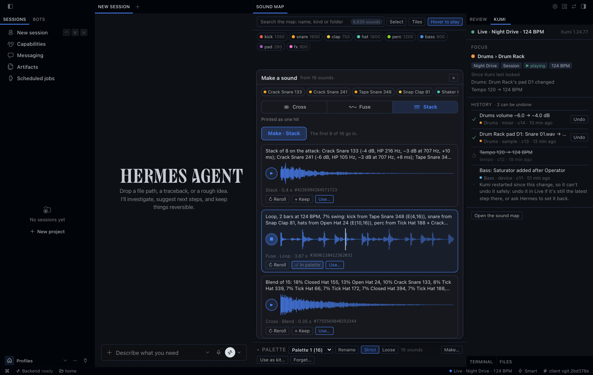
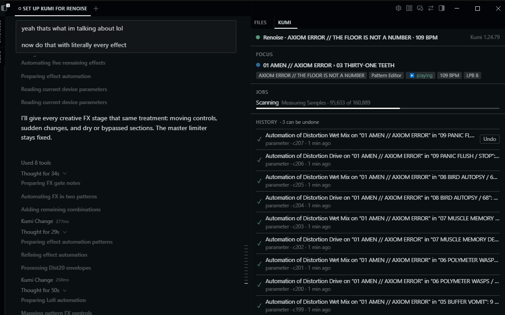
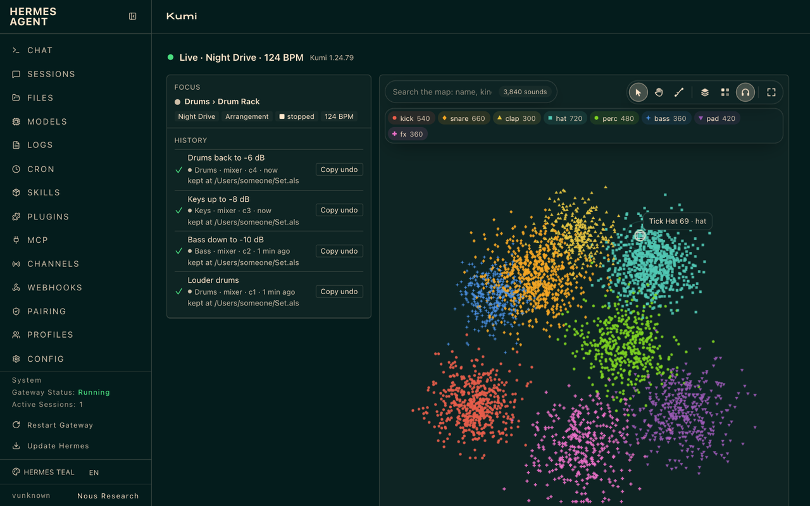

# Kumi for Hermes Agent

English · [简体中文](../zh-CN/HERMES.md) · [日本語](../ja/HERMES.md)

Kumi is also a plugin for [Hermes Agent](https://hermes-agent.nousresearch.com). Hermes stays your agent, in its
terminal, Hermes Desktop, the web dashboard or a chat app; Kumi gives it your DAW. Kumi makes the changes you ask for
(Hermes asks before each one only if you turn on **Ask before each change**), records each one in its HISTORY and can
undo most of them while it runs, and both run on your computer.

A standalone Kumi (the `kumi` app in a terminal) and Kumi for Hermes are separate installations. You don't need one to
use the other.

## Install

```sh
hermes plugins install kumi
hermes plugins enable kumi
```

`kumi` is Kumi's name in Hermes's plugin catalog. Until Kumi is listed there, install it from Kumi's repository with
`hermes plugins install user1303836/kumi#hermes-plugin`, then enable it the same way.

In Hermes Desktop, also turn on Kumi's **Desktop** switch under **Capabilities → Plugins**: a plugin's Desktop switch
starts off.

## Set up

Ask Hermes to "set up Kumi for Live" (or REAPER, or Renoise), or run `hermes kumi setup --daw reaper` in a terminal
(`--daw` takes `ableton`, `reaper` or `renoise`; without it, setup is for the DAW in Kumi's settings, Live unless you've
changed it). Setup has two steps and an optional third, and Hermes asks before each:

1. **Kumi's runtime:** Kumi's official release for your computer, 27–35 MB, from Kumi's GitHub releases. It's checked
   against the SHA-256 the plugin pins and unpacked into Hermes's own data for this profile (86–128 MB).
2. **Kumi's part in your DAW:** Live's Remote Script (with the Kumi Ears device), REAPER's
   extension or Renoise's tool, at the exact paths setup shows you. Quit Live first: its Remote Script can't be
   installed while Live runs. REAPER and Renoise can stay open; restart them after (on Windows, quit REAPER to update
   its extension).
3. **Optional, ffmpeg:** if an ffmpeg is already on your computer, setup offers to let Kumi use it to read MP3, FLAC
   and other compressed audio. Setup is done either way; without it, Kumi reads WAV and AIFF only.

Hermes Desktop shows each step's approval whole. A terminal chat or a chat app can show less of it, so there Kumi never
asks with part of a step: it asks you to run `hermes kumi setup` in a terminal, or to use Hermes Desktop.

Then, in your DAW:
- **Live:** choose **AbletonMcpBridge** as a Control Surface in Settings → Link, Tempo & MIDI.
- **REAPER:** restart REAPER.
- **Renoise:** enable the Kumi tool.

**No DAW?** The sound map, the palette and making sounds don't need one: once setup has installed Kumi's runtime (its
first step), ask Hermes to "add ~/Samples to Kumi's library and scan it" (any folder of WAV or AIFF files), then open
the sound map in its tab in Hermes Desktop, or in the web dashboard's Kumi tab. For the DAW side too, REAPER's free
evaluation takes about two minutes: install it from [reaper.fm](https://www.reaper.fm/download.php), then ask Hermes to
"set up Kumi for REAPER".

**Your sample folders.** If you know where your samples are, add the folder yourself, by its full path
(`C:\Users\you\Samples`, `D:\Samples`, `~/Samples`):
- **Hermes Desktop:** on the sound map, **Sample folders** (in an empty map, or the folder button in the map's
  toolbar) lists the folders Kumi reads. Type or paste a path, or press **Choose…** for the folder dialog, then **Add
  and scan**: the request goes to Kumi's chat, and Hermes asks once for the folder and its first scan.
- **Web dashboard:** the same control copies the request, to paste into a Hermes chat.
- **Terminal:** `hermes kumi samples` lists them. `hermes kumi samples add <folder>` shows what Kumi will read and asks
  before it adds the folder. Put a path that has spaces or `&` in quotes.
- **A chat:** `/kumi samples` lists them, and `/kumi samples add <folder>` adds one in Hermes's own apps (its terminal,
  Desktop). From a chat app (Discord, Slack, Telegram…) Kumi refuses.
- Every way goes through the same guard (the Sample folders setting below says what a folder can't be). A mistyped
  path is refused where you typed it, and a folder reached through a link is kept by where it really is.
- Nothing is read until a scan, whose approval names every folder it reads. Allowing scans for the session or for
  always covers those folders only: add one, and the next scan asks again. A folder that's gone (an unplugged drive)
  is left out of a scan, and Kumi says which. To remove a folder, edit Sample folders in Kumi's settings.

The first DAW you set up becomes Kumi's DAW (the DAW setting), in the same approval. Setting up another DAW later
leaves Kumi with the one it has; setup then names the step that switches: `hermes kumi setup --daw <daw> --use` in a
terminal, which asks before it changes the setting. You can also change the DAW in Kumi's plugin settings
(`plugins.entries.kumi.settings.daw` in your profile's config.yaml). Where Hermes's settings can't be written, setup
says so and where to set the DAW instead.

If another Kumi on this computer (a standalone Kumi, or Kumi for Hermes in another Hermes profile) already put its part
in Live, REAPER or Renoise, setup says so and offers to use that installation instead of replacing it, so you can go on
using both, even at the same time. Kumi for Hermes then reads that installation's connection files and writes its own
connection state there, never its sign-in or settings. In REAPER and Renoise it also uses that installation's listening
folder for the renders it asks for (and, in Renoise, its work folder for an instrument whose macro mappings it changes),
and keeps the DAW's write lease there; what it learns of your projects stays in its own data.

Setup never starts or quits your DAW, chooses a Control Surface, or saves your project.

## What you can ask

### Master your mix like a reference track

"Listen to my mix and master it like this reference track."
- **Listen:** in Live, REAPER and Renoise, Kumi listens to the part of your mix you ask for and measures it (asked
  first with Ask before each change on). In Live it hears each track after its devices and before its fader, through
  the Kumi Ears device setup installs (it needs Max for Live): Main's devices, its limiter included, are heard; Main's
  fader isn't, so Kumi reaches a target with Main's devices, never its fader.
- **Compare:** Kumi measures your mix beside the reference file: loudness, true peak, spectral balance, stereo width
  and dynamics. Wide and opposite-polarity stereo are measured accurately, spectral balance and crest factor included.
  A mono or silent file has no stereo width, and short audio may have no loudness or loudness range: Kumi shows them
  as unavailable rather than guess.
- **Part of a reference, or several:** "Compare it with the reference from 1:00 for 30 seconds" (60 seconds at most,
  inside the file), or with up to five references at once. Kumi measures them, weighted equally, into one target with
  its spread, and says how many of the references each measure comes from. A measure a reference can't give is left
  out of that measure, with the reason: a band above what its sample rate holds, say, or stereo width from a mono
  file. The spread includes minimum tolerances; it isn't a confidence. There's no single "better" score, no averaged
  audio and no true-peak target, and Kumi still proposes the mastering moves for you to decide on. An excerpt Kumi keeps
  plays from its own start.
- **Master:** it proposes mastering moves on the master track (EQ, glue compression, a limiter) as one change.
- **Repeat:** it listens again and compares, for at most three rounds. Each round's change is in HISTORY, and you can
  undo it.

### Write a beat or a bassline

"Write a four-on-the-floor kick with offbeat hats on a new track", then "now a bassline in A minor under it."
- Kumi writes the notes as one change.
- "Play it" starts playback; "Stop" stops it. Neither changes anything in the project
  but where play starts. REAPER plays from a bar or a beat, and Renoise from a sequence slot and line. In Live, Kumi
  launches a Session clip, such as the one it wrote or the one you've selected, or a scene, or plays the Arrangement
  from Live's own start marker. Kumi never starts a play that would record.
- "Make three variations of it: busier, sparser, and one with more swing." Hermes shows each take before you keep one;
  each is written as a new clip (an item in REAPER, a pattern in Renoise), never over the original. At most 8 takes.
  Where there's no empty place for every take, Kumi refuses rather than make fewer. To drop a take, undo it.

### Find a sample and use it

"Find me a dusty, dark snare."
- Kumi searches the sample folders you listed by how each sound measures, and by the words in its name and folder. In
  Hermes Desktop the sound map opens.
- Ask by tempo, key, length or kind too: "120 BPM drum loops in A minor", "a dark kick under 300 ms". Each result
  says why it matches, and on what: the tempo, key or note Kumi indexed at the folder's last scan (from the audio, or
  from a file's or folder's name; a rescan updates them), or what it measured ("dark", "bright", "dusty", "lo-fi",
  "punchy"). A tempo matches that tempo or half or double time, and a key the same key, its relative major or minor,
  or a one-shot's root note; the answer says which, and nothing is transposed. A sound with no indexed tempo or key
  isn't found by that filter. Artist and genre words match only names and folders: Kumi doesn't recognise genres or
  artists. "More like this" ranks by closeness to that sound among yours on this map, never a percentage. In Hermes
  Desktop, the map's list shows each sound's indexed values and why it matched. With several sounds picked, **More like
  these (N)** asks for sounds like all of them at once (up to 16); what Kumi finds lights up on the map, and **Pick
  all** picks it.
- "Use it on the snare" puts it in the snare's Simpler in Live (a Drum Rack pad's included), on a new track in REAPER,
  or in a new instrument in Renoise, as one change. "Put it on a new track" puts it in a new Simpler
  in Live.
- "Put it on pad 2" puts it on that Drum Rack pad in Live: into the pad's Simpler, or onto an empty pad in a new
  Simpler, one pad a change. Kumi can't undo a load onto an empty pad, and says so: Live's Undo
  usually takes it back in two steps, so press Cmd+Z one step at a time, right away, and stop as soon as the pad is
  empty. Live's Redo won't bring the sample back: ask Kumi to load it again. Kumi never clears a pad to make room. In
  Hermes Desktop, the map's **Use on pad…** puts that request in the chat.
- **Use…** on a map sound puts only its reference in the chat, its name and ids (“Rim Brixton” (sound … from map …)),
  so you say what to do with it; the dashboard copies the same words.
- **The map** fills its pane; the search, the tools and the groups float over it, each group in its own colour and
  shape. A sound plays as soon as the pointer reaches it (its first two seconds; **Hover to play** turns that off) or on
  a click, AIFF included; nothing changes in your DAW. The sound you click opens in the player at the map's foot: its
  waveform, kind, length and folder, and what you can do with it. A sound whose file is gone, or that the window can't
  play, fades off the map quietly, and one line counts them: **Show them** puts them back, and **Rescan…** puts a request
  to rescan your sample folders in the chat (in the dashboard, it copies the request). **Tiles** turns the map into
  square tiles in each group's colour, every sound on its own tile near its place; the dots morph into them and back.
  **Fit**, or a double-click, shows the whole map.
- **Layouts:** **Layout** lays the map out another way, and the sounds move to their new places: **Similarity** (sounds
  that sound alike together), **Character** (dark to bright, punchy to soft), **Texture** (tonal to noisy, high to low),
  **Keys** (round the circle of fifths), **Tempo** (by BPM), **Families** (an island for each kind), **Length** (a
  spiral from the shortest out) or **Folders** (an island for each top folder). Each writes its own labels on the map.
- **Reading the map:** each family glows in its colour under its sounds, with its name and count over it; zoom in,
  and sounds carry their own names where there's room. A sound that plays pulses as loud as it is. The sound under
  the pointer shows a label with its length and folder, and thin lines to the five sounds nearest it; rest on it as it
  plays and the label gains its waveform. With **Hover to play** on, the pointer leaves a trail in the colours of what
  it played. A box counts the sounds it holds as you draw it, and when the layout changes, the sounds fly to their
  places like a swarm. A sound Kumi made wears the colours of the families it came from, on its card and its
  waveform; point at it and the map rings the sounds it came from. In your palette, both show once the window knows
  what the sound was made from: it was made there, or **Make…** has been opened. The corner at the bottom left says
  how many sounds and families the map holds, its layout (a button that opens the layouts), the zoom, and what the
  pointer and the keys do right now; at first it also lists three steps (hear a sound, drag a box, press **Make…**),
  each gone once you've done it, or all with **Skip**. With your system set to reduce motion, the map keeps still: no
  trail, no swarm, and a playing sound is ringed without pulsing.
- **Picking and moving on the map:** a drag draws a box that picks the sounds in it, and Shift with a drag adds
  another box; Command or Ctrl with a click picks or unpicks one sound, and Shift with a click adds one. What the picks
  can do floats beside them. The middle button moves the map, as does a drag with **Move map** on (or with Space held,
  in the web dashboard). A mouse's wheel zooms; a trackpad's two-finger scroll moves the map and a pinch zooms. **Esc**,
  a click on empty map, or **Clear (N)** lets go of the picks.

### Your palette

The palette is the sounds you gather to work with, as in Kumi's own map; Hermes reads and edits the same one.


*Kumi 1.24.79 in Hermes Desktop; the 3,840-sound map and its samples are generated test data.*

- **Gather:** on the map, drag a box (Shift adds another), Command or Ctrl-click a sound to pick or unpick it, or
  **Pick all** for what a search or Kumi's find keeps; then **Add to palette**. A picked sound's own **Add to palette**
  takes just it. The palette's sounds are ringed on the map.
- **Under the map**, the palette is a drawer of cards: each sound's waveform in its group's colour, its name and kind,
  **Use…** (its reference in the chat; the dashboard copies it) and × to take it out. A click plays a sound, and a drag
  (or Alt with ← or →) moves it. **Fold** leaves one row of small chips (**Show all** opens it again), and dragging the
  drawer's edge makes it taller or shorter. Rename the palette, make another, switch between them, or forget one; its
  sounds stay in your library.
- **Strict or loose:** strict, Kumi uses only these sounds when you ask for your palette; loose, it may also offer
  each one's 5 nearest, and asks before adding any.
- **Use as kit…** puts "Load the sounds in my palette “…” as a kit" in the chat. In Live, Kumi then loads them onto
  a Drum Rack's empty pads from C1 up, one pad a change (Live's Undo takes each back).
- **Ask Hermes:** "add these kicks to my palette", "what's in my palette?", "make my palette loose", "load my
  palette as a kit". With **Tell the agent what you're looking at** on, Kumi's note to the chat names your palette.
- The palette is kept in this Hermes profile, apart from standalone Kumi's palettes.

### Making sounds

Kumi makes a new sound out of two or more of yours, as many as you pick (map sounds, palette sounds, or sounds Kumi
made before). Nothing in your project changes: the result is Kumi's own copy until you use it.



*Kumi 1.24.79 in Hermes Desktop; the samples are generated test data, and the made sounds come from Kumi's engine.*

- **Cross** them into one sound:
  - **blend:** one body morphed from all of them;
  - **attack:** one sound's hit on the body of the others;
  - **resonate:** some of them ring through the others, as if struck inside them. Choose who rings through whom (half
    through half, in order, every other one, bright through dark, hits through tones, one through all, or a chain),
    how they ring and for how long;
  - **modulate:** one sound shaped by the others. Choose which sound, which ways (phase, ring, AM, FM, filter, gain,
    spectrum) and how many stages; the recipe names each one.
- **Fuse** them into something longer:
  - **texture:** a bed that drifts between them and loops;
  - **loop:** a beat of their hits, or a melody of them repitched, 1 to 8 bars in any meter (7/8, 6/8…) at your
    project's tempo. Steer a beat by its swing, density, how busy each drum is, ghost notes, fills, rolls, open hats
    and whether its hits cluster at the start or the end; a melody by its key, scale (pentatonic to pelog), tuning (19,
    24 or 31-TET, just, Bohlen–Pierce…), notes bent off the scale, chords, glides and a held root;
  - **smear:** stretched 4 to 16 times longer, with a long, soft tail.
- **Stack** them into one layered hit, lined up on their attacks and balanced.
- **Grow** one sound toward another: the sounds in between, from just like the first to just like the second. One seed
  is one path; another seed takes another. On the map, **Grow** draws it as a vine: click a sound, then the one to grow
  toward (or pick two and press **Grow between**), and buds open along the vine as Kumi makes them. Click a bud to hear
  it, or drag the handle to grow any point between; **Keep**, **Use…**, **Make…** or **Grow from here** what you like,
  and **Another path** grows the vine again with a new seed.
- **Steer** any of them before it's made: darker or brighter, thinner or fuller, a filter, more tonal or noisier, softer
  or punchier, shorter or longer, drive, lo-fi, width and space; and for each sound, a pitch range, a chance to play
  backwards, a start point, a delay, pan and level, each sound drawing its own.
- **Reroll:** each result has a seed. Another seed is another take of the same recipe; the same seed makes exactly the
  same sound again. Each result comes with a one-line recipe that says what went into it.
- **Keep:** put a result in your palette, where it stays (Kumi otherwise keeps your 200 newest results).
- **Use…** puts only the result's reference in the chat, its name and id (“Smear of 8 at 9.8×…, seed …” (artifact
  …)), so you say what to do with it; putting it on a pad or a track is a change of its own, asked as your changes are.
- **On the sound map, in Desktop or the web dashboard:** pick sounds (or open your palette) and press **Make…** (in
  Desktop, on a wide map the panel opens beside it, and the map moves over when it fits there; the dashboard shows the
  panel under the map), choose **Cross**, **Fuse**, **Loop** or **Stack** and then a way to do it. Set its choices or
  leave any on **Auto** (the seed draws it, so **Reroll** varies
  it): Resonate's pairing, what rings and the ring time; Modulate's played sound, the stages it may use, how many and
  how often they retrigger; the **Loop** tab's **Beat** or **Melody**, its tempo (your project's until you move it),
  bars, and its **Rhythm**, **Voices**, **Feel**, **Harmony** and **Line**. **Steer** shapes any of them (**Surprise**
  moves a few controls at random, **Reset** puts them back; each way keeps its own steer). Press **Make**: the new sound
  plays as it arrives (press ▶ or its waveform to hear it again), and a modulate result shows its stages in a row.
  **Reroll**, **Keep** and **Use…** are on each result (the dashboard copies Use's words instead), ‹ › steps through a
  result's variations, and the results stay after a reload. A kept sound flies into your palette. Choose results (✓)
  and **Make from these**, or **Add to the sounds**, to make from what you made, generation after generation; **Back**
  returns to the sounds before.
- **Ask Hermes:** "blend these three kicks", "make a texture from my palette", "stack this snare with that clap",
  "reroll it", "put the second one in my palette", "load it on pad C2".

### And the everyday ones

- "What am I looking at?" Kumi reads the track, device and clip you have selected.
- "What does Drive do on this Serum?" In Live, Kumi reads its guide to that plug-in and the parameters you've
  configured for it; in any DAW, its catalog of plug-in formats and which controls it has verified. It only reads: it
  doesn't scan your installed plug-ins, press Configure, or write presets, tunings or wavetables. A range of values
  Kumi has only seen isn't one it promises.
- "Make a warm Serum 2 pad." In Live, Kumi works as it does on its own: it builds the patch as a preset (below) from
  the controls Kumi has verified (for Serum 2, its oscillators, unison, filter, envelopes, LFO rate, macros and
  mod-matrix routes, such as LFO 1 to the filter's cutoff at a set depth), and
  turns the plug-in's configured knobs by name, following its recipes. Live lets it turn only knobs configured in the
  device, so for more it opens the plug-in's window and asks you to click Configure and move them once.
- "Make the bass 3 dB quieter." Kumi makes the change, tells you exactly what changed, and adds it to HISTORY.
- "Send the bass's output to the Drum Bus." Kumi routes where a track's output goes. In Live it doesn't change a
  track's input, arm it or change its monitoring: those are for recording.
- "Add a chain to the Instrument Rack on the keys track." In Live, adding a chain to a rack is a change only Live's own
  Undo takes back (see [Limits](#limits)).
- "Compare these two bounces." Kumi measures both files: loudness, true peak, spectrum.
- "Stop the scan." A long scan of your sample folders stops when you ask. You keep the sound map you had, unless the
  scan had already begun saving its new one.
- "Undo that." Kumi undoes your newest change in this chat, every step of it, and lists them.
  "Undo the snare change" undoes that entry while it can still be undone.
- "Make the bass from this tutorial: <a YouTube link>." Hermes reads the video's transcript and, where values are
  only on screen, views those moments in its browser or asks you for a screenshot. Then Kumi builds it with typed
  changes. Kumi downloads no video.

Kumi also works with sounds from ElevenLabs and Mirelo: see [Integrations](#integrations-optional).

### Scripts and Max for Live devices

When no change Kumi knows fits, Hermes can write code for it.
- **A script:** "Write a Lua script in Renoise that reverses every other pattern." Python in Live, Lua in REAPER and
  Renoise. When it's asked, the approval shows what Hermes says it's for, its first lines, its size and SHA-256, and
  where the whole script is saved; Hermes Desktop shows all of it. A script runs with your DAW's access to your
  computer, and Kumi stops it after 10 seconds (0.8 in Renoise). Kumi can't undo a script: your DAW's own Undo may.
  HISTORY keeps the code, and its **Show code** shows it again.
- **A Max for Live audio effect:** "Build a Max for Live soft clipper with drive and tone, and put it after the bass's
  EQ." Kumi writes a new device from GenExpr code into `User Library/Kumi/Audio Effects`, with up to 16 controls of
  its own, plus Mix and Output. What it adds is held under −0.3 dBFS; the track's own signal passes through
  untouched. Hermes Desktop shows its controls and code when it's asked. Putting it in your Set is a second change:
  Kumi loads it at the end of the track's chain, and can undo that. Moving it from there is a third
  change, which only Live's own Undo takes back. The file stays in your User Library after an undo.
- **Asked every time, once a chat has read outside content:** web pages, transcripts, files Hermes fetched from the
  internet, another plugin's results, or any terminal command or code run. Files already on your disk, installed
  skills, and the names in your library and projects don't count. In such a chat, each script and device is asked
  with its code, and none runs while Hermes's approvals are off. In a chat that hasn't, a script runs and a device is
  built without asking unless Ask before each change is on; with it on, allowing a script for the session covers that
  chat's scripts.
- **Refused before anyone is asked:** a script, or a device's code, over 400 lines or 32 KB; a script with a hidden or
  direction-changing character, or one that runs processes or reaches the network (`os.execute`, `io.popen`,
  `subprocess`, `os.system`, `socket`, `urllib`, `ctypes`). That check is a safeguard, not a sandbox.

### Presets for your plug-ins (Live)

"Make a Pro-Q 4 preset that cuts the mud around 300 Hz." In Live, Kumi builds a new preset for Serum 2 (2.1.5),
Pro-Q 4 (4.1.3.0) or Ozone 12 (12.1.0), only for the version you have installed, starting from the plug-in's
initialized settings and changing up to 512 controls Kumi has verified, with the same preset writer as Kumi itself.
- **Building it changes nothing:** Kumi keeps a private copy and says each setting before and after, as the preset file
  stores it.
- **Putting it in your User Library** (asked first with Ask before each change on): Kumi shows the plug-in and the
  version installed, every setting, "Values as the preset file stores them; the plug-in may show them differently.",
  and the new file in
  `User Library/Kumi/Instruments` or `User Library/Kumi/Audio Effects`. The file stays there after an undo. Allowing
  one preset, for the session or always, covers that file only: each new preset is asked.
- **Loading it on a track is another change.**
- Kumi never opens your own presets, runs the plug-in or downloads anything to build one. A plug-in that isn't
  installed, or whose installed version Kumi hasn't verified, is refused.

### Judged rounds and wavetables (Live)

"Get this to −14 LUFS with a −1 dB ceiling." Kumi works toward a loudness, a true peak or a reference's balance in
rounds (`kumi_judge`): it hears the stretch, lists the gaps, and after each change you make keeps it only if it helped,
otherwise takes it back itself. `kumi_tune` lets Kumi pick a device's numbers in such a round. Each round is a change in
HISTORY that you can undo; Live plays the stretch through Kumi Ears with Live stopped, and puts it back after (asked
first with Ask before each change on). For Serum 2 or Vital, `kumi_wavetable` writes a new wavetable file you then pick
in the plug-in's window; it stays after an undo.

### Sounds, auditions, grooves, renders and form (Live)

"How do the kick and bass sit together?" `kumi_sound` measures up to 8 tracks heard side by side in one pass: each
sound's envelope, tone, effects (reverb time, echoes, pumping), its problems, a kit verdict and how one ducks under
another. "Which of these three pads is closest to the reference?" `kumi_audition` plays the part once and scores up to 8
candidate tracks against a reference (a clip in the Set or a sound, a file Kumi made or an approved file; 60 s of it at
most). Both play through Kumi Ears with Live stopped, at most 60 s a pass counting a bar before and half a bar after,
and put everything back (asked first with Ask before each change on). "Make my hats swing like this loop."
`kumi_groove` shapes a MIDI part's feel toward a reference MIDI clip's on the notes, without listening; `apply` moves
the notes as a change you can undo. `kumi_render` renders up to 60 s of an audio track's own clips offline and keeps the
file for `kumi_listen`. "Where does the chorus first hit, and does the second verse drag?" `kumi_form` plays the whole
Arrangement once while you wait and reads it bar by bar: energy over the song,
sections, turns, the first hook and which tracks play where, beside a reference's form if you give one. It plays up to
about 6½ minutes with Hermes's default tool deadline, or up to 15 if you raise `timeouts.tools.sequential_call` in
Hermes's config.yaml; a longer song is read in parts. Stop ends it.

**What asks first.** By default Kumi makes your changes, undos, track and mix listens, play, takes, presets, and
scripts and devices in a chat that hasn't read outside content without asking: each goes into HISTORY, and most can be
undone. Setup steps, sample-folder adds and scans, Mirelo uploads and paid generations, and a script or device in a
chat that has read outside content always ask. Turn on **Ask before each change** in Kumi's settings in Hermes
(`ask_before_changes` in the plugin config) and Hermes asks before each of them, per kind of change and per chat. Kumi
never approves anything in Hermes itself. `/kumi`, `hermes kumi status` and `hermes kumi doctor` say which applies,
for example "Approvals: Kumi makes your changes and runs your scripts without asking (Ask before each change: off);
setup steps, sample folders and Mirelo jobs still ask".

Allowing a Kumi call for the session or always covers that kind of call in this chat only, including a one-shot run
that resumes it (`hermes chat -q --resume`); another chat, a new one-shot run or a scheduled job asks again or is
refused. Scheduled jobs and webhooks never change anything. A new one-shot `hermes chat -q` run can: Kumi can't tell
it from a chat, since Hermes runs its tools in its gateway, so by default it makes the changes and runs the scripts it
asks for, as a chat does. With Ask before each change on, Hermes refuses them there, since nobody can answer; it
refuses setup steps, sample folders and Mirelo jobs there either way. Kumi acts only in your own turns: when Hermes
works on the chat in the background (its review after a turn) or answers a side question (`/btw`), Kumi only reads,
whatever you allowed. With Ask before each change on, a change only your DAW's own Undo takes back asks under its own
kind, so allowing other changes doesn't cover it. A setup step's approval covers its own plan. Choosing **Always**
leaves an entry in Hermes's `command_allowlist` (your profile's config.yaml) that Kumi never edits: to remove it,
delete the `plugin_rule:kumi:` entries there.

With `--yolo`, a chat's `/yolo` or `approvals.mode: off`, Hermes runs Kumi's changes, undos, listens, play,
sample-folder adds and scans, setup steps, and, with Mirelo set up, its paid generations and uploads (up to your credit
cap) without asking. Scripts and devices also run unasked there, but only in a chat that hasn't read outside content:
in one that has, they're refused. `/kumi` says so, as `hermes kumi status` does when `approvals.single_query_mode` or
`delegation.subagent_auto_approve` lets changes pass unasked. A one-shot `hermes -z` turn is yolo too: Kumi's calls
run without asking there, and Kumi can't tell it from a chat.

## Where things are

- **Every surface:** Kumi's tools, its skills (`kumi:daw`, `kumi:sounds`, `kumi:listening`, and `kumi:generate` for
  Mirelo), `/kumi` for status, and `@kumi:focus`, `@kumi:history` or `@kumi:status` in a message to attach what Kumi
  last saw.
- **Hermes Desktop:** a status chip, a side pane with FOCUS and HISTORY, the sound map in its own tab with your
  palette under it, cards for measured audio, and commands in Hermes's command palette. While a script or device waits
  for your approval, the pane shows its whole code (and a device's controls); a script's HISTORY row has **Show
  code**. With nothing in HISTORY yet, the pane offers three requests to try (**What am I looking at?**, a small
  change and a find), each put in the chat for you to send. Buttons never change your project directly: a project
  change goes into the chat as a request, through the same path as a typed one, while Make, the palette and hiding
  sounds that can't play write only Kumi's own data.
- **Web dashboard:** a Kumi tab with HISTORY, status, the map and your palette.
- **The dot** beside Kumi's status (in the chip, the pane and the dashboard) pulses at your DAW's tempo while it plays,
  and sits still when it's stopped.





Screenshots: the pane is Kumi 1.24.73 on real Ableton Live 12. The map, palette, Make and dashboard shots are Kumi
1.24.79 on a generated 3,840-sound test map, with the made sounds from Kumi's sound-design engine. Hermes's side of the
chat came from a scripted stand-in model, so the words are illustrative; Kumi's side is real.

## Settings

| Setting | Default | What it does |
|---|---|---|
| DAW | Live | Which DAW Kumi connects to. The first DAW you set up becomes it; switch with `hermes kumi setup --daw <daw> --use` (`ableton`, `reaper` or `renoise`) |
| Sample folders | none | The folders Kumi may read for your sound map: a scan reads only the audio files in them, and nothing else is scanned. A folder can't be a whole drive or volume, your home folder or a folder above it, or a folder inside or above Hermes's own (`HERMES_HOME`); `~/` works. Links and junctions never lead Kumi outside the folders you list, and on Windows it skips cloud placeholder files (OneDrive's, for example) |
| Tell the agent what you're looking at | on | When what you're looking at changes, adds a short note to the chat connected to Kumi: what you're on (FOCUS), and what changed in the project while Kumi was away |
| Ask before each change | off | Hermes asks before each Kumi change, undo, track or mix listen, play, take, preset, script and device, per kind of change and per chat. Off, Kumi makes them without asking and records each in HISTORY; setup steps, sample folders and Mirelo jobs ask either way, and so does a script or device in a chat that has read outside content |
| Run scripts from messaging chats | off | Lets a messaging chat (Discord, Slack, Telegram…) ask to run a script in your DAW, or to build a Max for Live device. Each one is asked, with its code, whatever Ask before each change says, and none runs while Hermes's approvals are off |
| Interpret measurements with a model | off | Also sends measurements and a small band-energy image for a plain-words reading to the model set for Kumi's listening task in Hermes (Vision's, unless you change it), which must accept images |

## What leaves your computer

- **Setup** downloads Kumi's runtime from Kumi's GitHub releases, once per Kumi version.
- **Your conversation:** the project details Kumi notes (FOCUS, what changed) and its measurements go to the model you
  use in Hermes, as part of the chat. Kumi's status tells it where setup stands without naming any folder on your
  computer.
- **Interpret measurements with a model** (off unless you turn it on) sends the measured numbers and a small image of
  the measured band energy, never the audio or file paths, to the model set for Kumi's listening task in Hermes, or to
  the fallback providers Hermes is set to try for that task. Retries and fallbacks can add time and token cost.
- **Audio stays here:** Kumi measures audio on your computer and sends none of it to a model. In a messaging app
  (Telegram, Discord…), a sound you ask Hermes to send you arrives there as an attachment, through that app.
- **Listening to a track or the mix:**
  - **Window:** it listens only to the window you ask for, 60 seconds at most (in Live, 256 beats at most, in the
    Arrangement), with the DAW stopped; it asks first with Ask before each change on. Kumi won't stop playback for you.
    The one exception is reading a song's form (`kumi_form`): it plays the whole Arrangement once while you wait, up
    to about 6½ minutes with Hermes's default tool deadline (up to 15 if you raise `timeouts.tools.sequential_call`; a
    longer song is read in parts), and Stop ends it.
  - **Your project:** the render's temporary transport, routing and device settings are put back after. REAPER may
    show the project as modified after a listen, since only saving clears that flag; Kumi never saves.
  - **Renoise's tempo:** rendering can change its BPM and lines per beat. Kumi puts them back only if they're still
    what the render left; if they're different, it leaves both as they are and says it couldn't restore the tempo.
  - **The audio:** the DAW renders into the listening folder of Kumi's part in that DAW; Kumi copies that one file into
    its own data and measures it there.
  - **Live:** Kumi captures the window through Kumi Ears, with Live stopped and not recording, and removes the device
    after; Detail View then shows the clip you had open again. Live may show the Set as modified, and its own Undo
    history holds the listen's temporary device steps: pressing Undo in Live can bring Kumi Ears back. Those steps
    aren't changes in Kumi's HISTORY.
- **Scripts** run with your DAW's access to your computer: what one reads, writes or sends follows its code. Kumi
  keeps each script's code in its own data.
- **Max for Live devices** are new files Kumi writes into Live's User Library (`User Library/Kumi/Audio Effects`),
  outside Kumi's own data. They stay there until you delete them.
- **Wavetables** are new `.wav` files Kumi writes (never over a file) into Vital's wavetable folder
  (`~/Music/Vital/User/Wavetables`; `~/Documents/Vital/User/Wavetables` on Windows) or Live's User Library
  (`User Library/Kumi/Wavetables`, for Serum 2 and others), outside Kumi's own data. They stay after an undo.
- **Judged rounds and tunes** play the stretch in Live through the Kumi Ears device setup installed, placed on the
  track or before Main, with Live stopped and not recording, and remove it after (Live's own Undo history keeps those
  temporary device steps). A pass lasts at most 60 s, counting the bar Live plays before the stretch and the half bar
  after it; a judge or tune pass may play once more when Live started late, under the same limit. What Kumi hears stays
  in its own data until the call ends. Measuring sounds and auditioning play the same way; an audition of Session clips
  plays them from temporary copies in the Arrangement, removed after. A groove's `apply` and a groove round taken back
  change a MIDI clip's notes as changes in HISTORY. A render keeps up to 60 s of a track's own clips in Kumi's own data
  and deletes Live's temporary render file. Reading a song's form plays the whole Arrangement once the same way while
  you wait, for as long as Hermes's tool deadline allows (about 6½ minutes by default, up to 15 if you raise
  `timeouts.tools.sequential_call`; a longer song is read in parts), and Stop ends it at once. A tune's search or probe makes scratch copies of the run's track in
  the Set and removes them after; if Kumi stops partway, its next look (`kumi_observe`) removes leftovers. There's no
  record pass, and no model is downloaded: a run goes by its meters.
- **Plug-in presets** you put in your User Library are new `.vstpreset` files Kumi writes into Live's User Library
  (`User Library/Kumi/Instruments` or `User Library/Kumi/Audio Effects`), outside Kumi's own data. They stay there
  until you delete them. To tell which version of Serum 2, Pro-Q 4 or Ozone 12 you have, Kumi reads the VST3
  metadata in your standard plug-in folders; it never loads a plug-in.
- **A copy of your project:** before some changes, Kumi copies your project as last saved beside it, once for each
  saved version. An unsaved project gets no copy, and Kumi never saves the project itself.
  - Live: when a change reaches its third step (`<Set>.backup-<date>.als`). The copy stays until you delete it.
  - Renoise: before a change that loads a sample, such as a sound from your library put in an instrument
    (`<Song> (Kumi copy <date>).xrns`). Kumi keeps a song's five newest copies and deletes older ones. A song over
    512 MB isn't copied.
  - The change that kept a copy says so, with the copy's name. In Hermes Desktop, its HISTORY row reads "Before this,
    Kumi kept a copy of the project as last saved, next to it: <file>".
- **Mirelo,** only if you set it up: see [Integrations](#integrations-optional).
- **Scheduled jobs** (Hermes cron) read only Kumi's status and HISTORY as last published. Their answer (change titles,
  track names) leaves your computer only through where the job delivers; Kumi's job blueprints deliver locally by
  default.
- Kumi for Hermes never uses a standalone Kumi's sign-in, model providers or updater, and sends no telemetry.

## Limits

- Your DAW must run on the computer that runs Hermes. Hermes Desktop connected to a remote Hermes controls that
  computer's DAW, not yours.
- Live 12 works on macOS and Windows. Kumi is tested on Live 12.4 (beta); Live 12.0 to 12.3 are untested and have no
  Extension Host for Kumi's Live extension, so there Kumi can't render offline, write MIDI clips into the Arrangement or
  clear a range in it. REAPER 7 and Renoise 3.5 or later work on macOS, Windows and Linux.
- Kumi listens to the window you ask for, up to 60 seconds (in Live, 256 beats at most, in the Arrangement); reading
  a song's form in Live plays the whole Arrangement once, up to about 6½ minutes with Hermes's default tool deadline
  (up to 15 if you raise `timeouts.tools.sequential_call`). In every
  DAW it measures audio files, library sounds and Kumi's own results.
- Kumi reads only the open project, the audio files in the sample folders you list, its renders and captures of the
  windows you ask for, and finished audio other Hermes plugins saved in Hermes's generated-audio folder
  (`<HERMES_HOME>/cache/generated/audio`, which Kumi never creates), to place or measure it.
- Kumi reads WAV and AIFF itself. For MP3, FLAC and other compressed audio it uses an ffmpeg already on your
  computer, if you allow it at setup; it never downloads one. Before each start Kumi checks that it's still the ffmpeg
  file you allowed (not the libraries it loads, which an upgrade can change). ffmpeg gets only the one file Kumi is
  reading: never a URL or a playlist, and nothing from the network. A file Kumi reads can be up to 50 MiB, and it
  measures at most 12 minutes of it.
- Kumi's REAPER extension keeps an id in a saved project, and its Renoise tool keeps one in a song, only when a
  standalone Kumi connected to that DAW asks it to; Kumi for Hermes never asks. Once kept, the id is saved with the
  project.
- On Windows, a sample in a network folder (`\\server\share`, or a share reached through a link) can't be played in
  Hermes Desktop or the dashboard: they play only files on this computer's own drives.
- Stop in Hermes Desktop or Hermes's terminal UI, or `/stop` or `/new` in a chat app, cancels a Kumi change, undo or
  listen still running. Kumi can't then tell whether it finished, so check HISTORY before asking again. In the classic
  `hermes chat` CLI, Stop doesn't reach Kumi: the call runs until it finishes or reaches its time limit.
- Kumi can undo a change only while the Kumi runtime that made it is still running. The runtime stops when its chat
  ends, when Hermes unloads the plugin or exits, or after 15 minutes with nothing to do (2 hours while it's connected
  to your DAW for a chat). A job it's running, such as a library scan, keeps it going for up to 6 hours.
  After it stops, the change stays in HISTORY, and your DAW's own Undo is the way back.
- In Live, a few changes only Live's own Undo takes back: adding a chain to a rack, moving a device, and loading a
  sample onto a pad. Kumi says so first, with how Cmd+Z (Ctrl+Z on Windows) takes the change back, and
  HISTORY marks the row. Undo right away: if you've done anything in Live since, Cmd+Z takes that back first. Such a
  change holds nothing else: Kumi makes any other steps separately. A script is the same in every DAW: Kumi can't
  undo it, and the DAW's own Undo may.
- In Live, Kumi won't undo a change to a track's mixer, the tempo or a device's parameters if you've changed that
  value by hand since: the undo says so and changes nothing. An undo shows each value as it is now and
  as the undo would put it back. In REAPER and Renoise, an undo puts the value back even if you've changed it by hand
  since.
- In REAPER and Renoise, an edit you make by hand while Kumi is connected isn't listed when you ask what changed;
  Kumi's next look still shows the project as it is.
- Kumi builds plug-in presets only in Live, and only for Serum 2 (2.1.5), Pro-Q 4 (4.1.3.0) and Ozone 12 (12.1.0). In
  REAPER and Renoise it says so ("Kumi builds plug-in presets only for Ableton Live for now.") and writes nothing.
- Kumi for Hermes doesn't drive Live's menus, record, or save or open projects. In Live it doesn't group tracks: select
  them and press Cmd+G (Ctrl+G on Windows).

## Integrations (optional)

Core Kumi needs neither of these.

### Sounds from other Hermes plugins (ElevenLabs)

"Make a riser with ElevenLabs and put it on the FX track." When another Hermes plugin has made a sound, Kumi can
measure it or put it in your project. It reads only finished audio in Hermes's generated-audio folder
(`<HERMES_HOME>/cache/generated/audio`, which Kumi never creates) and copies the file into its own data first; placing
it is a change like any other.

### Mirelo (paid)

"Make a vinyl crackle with Mirelo" or "Turn this bassline into MIDI." With a [Mirelo](https://mirelo.ai) account, Kumi
can ask Mirelo for a sound effect from a prompt or for MIDI notes from an audio file.

- **Off until you turn it on:** in Kumi's settings, add your **Mirelo API key** (a Hermes secret, `MIRELO_API_KEY`),
  turn on **Use Mirelo for paid generation** and the kinds you want (**Mirelo sound effects**, **Mirelo audio to
  MIDI**), and set a **Mirelo credit cap** above 0 (the default, 0, refuses every paid generation). A key alone never
  makes Kumi use Mirelo.
- **Credits, never money:** each generation asks first with Mirelo's estimate in API credits, and that approval
  covers only that estimate, once. Sending an audio file for MIDI is approved on its own; allowing it for the session
  covers only that file, in that chat. The cap counts over Kumi's whole life: each generation reserves up to its
  estimate, a charge may stay unknown until Mirelo reports it (its reservation keeps counting meanwhile), and a charge
  above its estimate pauses new paid generations. Nothing is paid for or uploaded in scheduled jobs,
  `hermes chat -q`, webhooks or Hermes's API server.
- **Your credits, in a terminal:** `hermes kumi credits` shows what's spent, reserved and left, and the open
  reservations. `hermes kumi credits unfreeze` lets paid generations start again; `hermes kumi credits release <id>`
  releases a reservation whose charge stayed unknown, after you've checked Mirelo's dashboard (a charge Mirelo reports
  for it later still counts, and pauses new paid generations). Each asks you first, and they're yours alone: Hermes
  and its model can't run them.
- **What leaves:** your prompt, and for MIDI the audio file you approve, go with your key to `api.mirelo.ai` and to
  the upload and download links Mirelo's API gives for each job, on hosts Mirelo chooses (its storage or delivery
  network), so they aren't a fixed list. Whether Mirelo trains on what you send follows your Mirelo account's
  settings; Kumi has no setting of its own for it.
- **What comes back** is kept in Kumi's data. Placing it is a separate change, and MIDI notes come
  timed in seconds. An audio file for MIDI must fit Mirelo's limits (30 minutes, 50 MiB); MP3 and other compressed
  audio need the ffmpeg allowed at setup. Switching a kind off stops new generations of it (one already running is
  still fetched while your key is set); removing the key stops Kumi contacting Mirelo.

### Their sounds in your projects

A sound from either that you put in a project stays in this profile's `plugin-data/kumi/` folder, and the project
plays it from there. Before you delete that folder, save such projects with their files copied in (Live: **File →
Collect All and Save**; REAPER: **Save project as…** with **Copy all media into project directory**), or they'll miss
those samples.

## If something isn't working

- `hermes kumi doctor` (or `/kumi doctor` in a chat) checks what Kumi needs in this Hermes profile: Hermes's approval
  settings and whether Kumi asks before each change, setup, the connection, the open project and the sound map. For
  each problem it says what to do. It changes nothing.
- `/kumi` (or `hermes kumi status` in a terminal) says what setup still needs, and whether Kumi can read compressed
  audio. With `plugins.isolation: host`, Hermes leaves plugin commands such as `hermes kumi` out: set Kumi up from a
  chat in Hermes Desktop instead.
- No sound map, or a folder's sounds aren't on it: `hermes kumi samples` (or `/kumi samples`) lists the folders Kumi
  reads. Add one with `hermes kumi samples add <folder>` or the map's **Sample folders**, then ask Hermes to scan.
- Nothing from Kumi in Hermes Desktop: check Kumi's **Agent** and **Desktop** switches under Capabilities → Plugins,
  and that it's enabled in Hermes (`hermes plugins enable kumi`).
- No Kumi tab in the web dashboard: if the dashboard was already running when you installed Kumi, restart it
  (`hermes dashboard`).
- Live doesn't connect: check that AbletonMcpBridge is chosen as a Control Surface.
- REAPER isn't answering (a change comes back "unsure", or Kumi's status says a dialog is probably open): a REAPER
  window is waiting for you, such as the evaluation reminder or the audio device question. Close it in REAPER, then
  ask again.
- A listen is refused because Kumi's part in your DAW is older: run setup again, which updates it, then restart the
  DAW.
- A listen in Live says Kumi Ears is missing or unavailable: it needs Max for Live. Run setup again; listening never
  installs it.
- A listen in Live says "Live is not following the Arrangement": press Back to Arrangement in Live, then ask again.
- A listen asks you to stop playback, or Renoise "is not ready to render": stop playback and recording, turn off
  Renoise's Edit Mode, and wait for its tempo scan to finish. Kumi won't stop playback or recording for you.
- "Play it" is refused while your DAW records or its record is on: Kumi never starts a play that would record. Turn
  recording off in the DAW first.
