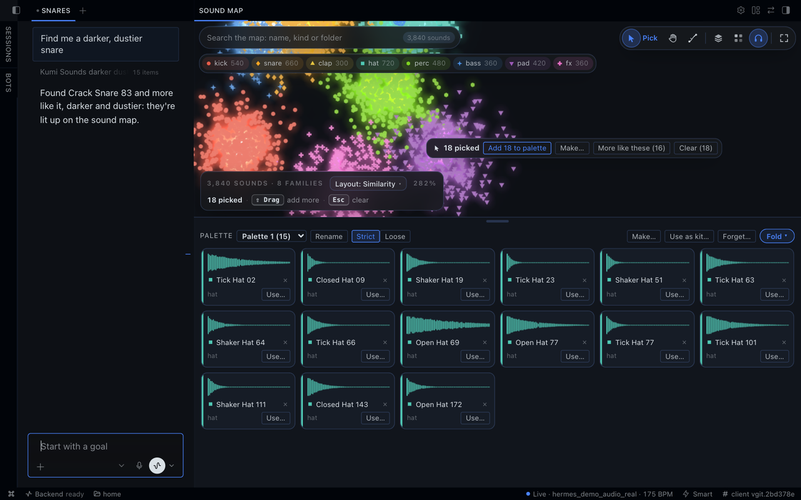
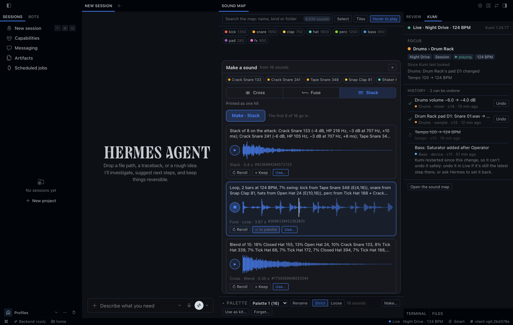
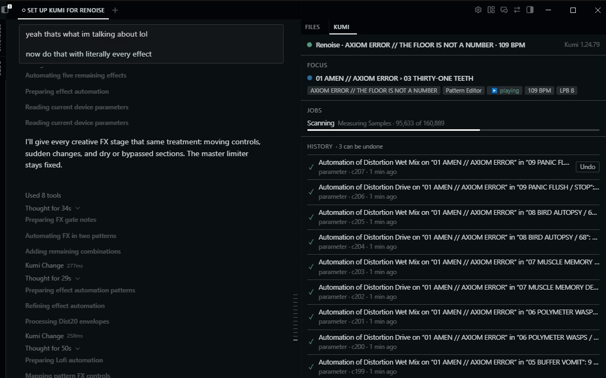
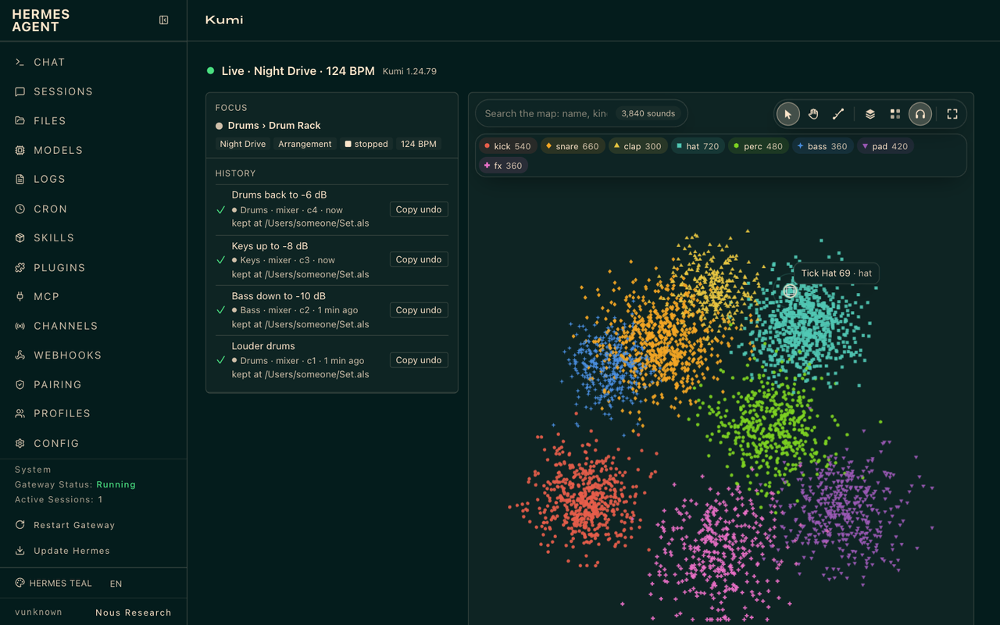

# Kumi for Hermes Agent

[English](../en/HERMES.md) · [简体中文](../zh-CN/HERMES.md) · 日本語

Kumi は [Hermes Agent](https://hermes-agent.nousresearch.com) のプラグインとしても使えます。エージェントは Hermes のまま（ターミナル、Hermes Desktop、Web ダッシュボード、チャットアプリ）で、Kumi はそこに DAW を加えます。Kumi は頼まれた変更をそのまま行い（**Ask before each change** をオンにしたときだけ、Hermes が変更のたびに確認します）、それぞれの変更を HISTORY に記録します。Kumi が動いているあいだは、そのほとんどを取り消せます。どちらもあなたのコンピューターで動きます。

単体の Kumi（ターミナルで使う `kumi` アプリ）と Kumi for Hermes は別々のインストールです。どちらか一方だけでも使えます。

## インストール

```sh
hermes plugins install kumi
hermes plugins enable kumi
```

`kumi` は Hermes のプラグインカタログでの Kumi の名前です。Kumi がカタログに載るまでは、Kumi のリポジトリから `hermes plugins install user1303836/kumi#hermes-plugin` でインストールし、同じように有効にしてください。

Hermes Desktop では、**スキルとツール → プラグイン** で Kumi の **Desktop** スイッチもオンにしてください。プラグインの Desktop スイッチは最初はオフになっています。

## セットアップ

Hermes に「Live 用に Kumi をセットアップして」（REAPER や Renoise でも）と頼むか、ターミナルで `hermes kumi setup --daw reaper` を実行します（`--daw` に指定できるのは `ableton`、`reaper`、`renoise` です。省略すると Kumi の設定の DAW 用で、変えていなければ Live です）。セットアップは 2 段階と任意の 3 段階目で、それぞれの前に Hermes が確認します。

1. **Kumi のランタイム:** お使いのコンピューター向けの Kumi 公式リリース（27〜35 MB）を Kumi の GitHub リリースからダウンロードします。プラグインが固定している SHA-256 と照合し、このプロファイル用の Hermes のデータ内に展開します（86〜128 MB）。
2. **DAW 用の Kumi の部品:** Live の Remote Script（Kumi Ears デバイスを含む）、REAPER の拡張機能、または Renoise のツールを、セットアップが示す正確な場所にインストールします。Live は先に終了してください。Live の起動中は Remote Script をインストールできません。REAPER と Renoise は開いたままでかまいません。終わったら再起動してください（Windows で REAPER の拡張機能を更新するときは、REAPER を終了してください）。
3. **任意の ffmpeg:** すでにコンピューターに ffmpeg がある場合、MP3、FLAC などの圧縮音声を読むために Kumi がそれを使ってよいかを確認します。どちらを選んでもセットアップは完了します。使わない場合、Kumi が読めるのは WAV と AIFF だけです。

Hermes Desktop は各段階の確認内容をすべて表示します。ターミナルのチャットやメッセージアプリでは一部しか表示されないことがあるため、そこでは Kumi が段階の一部だけを示して確認することはありません。代わりに、ターミナルで `hermes kumi setup` を実行するか、Hermes Desktop を使うよう案内します。

そのあと DAW で:
- **Live:** 設定 → Link, Tempo & MIDI で **AbletonMcpBridge** をコントロールサーフェスに選びます。
- **REAPER:** REAPER を再起動します。
- **Renoise:** Kumi のツールを有効にします。

**DAW がなくても:** サウンドマップ、パレット、サウンドを作る機能は DAW なしで使えます。セットアップが Kumi のランタイムを入れたら（最初の段階）、Hermes に「~/Samples を Kumi のライブラリに追加してスキャンして」と頼み（WAV か AIFF のファイルがあるフォルダーなら何でも）、Hermes Desktop のサウンドマップのタブか、Web ダッシュボードの Kumi タブを開きます。DAW 側も試すなら、REAPER の無料評価版なら 2 分ほどで始められます。[reaper.fm](https://www.reaper.fm/download.php) からインストールし、Hermes に「REAPER 用に Kumi をセットアップして」と頼みます。

最初にセットアップした DAW が、同じ確認のなかで Kumi の DAW（DAW 設定）になります。あとから別の DAW をセットアップしても、Kumi は今の DAW のままです。その場合、セットアップの最後に切り替える手順（ターミナルで `hermes kumi setup --daw <daw> --use`）が示され、設定を変える前に確認されます。Kumi のプラグイン設定（プロファイルの config.yaml の `plugins.entries.kumi.settings.daw`）で DAW を変えることもできます。Hermes の設定に書き込めない環境では、セットアップがそのことと、DAW を設定する場所を伝えます。

このコンピューター上の別の Kumi（単体の Kumi、または別の Hermes プロファイルの Kumi for Hermes）がすでに Live 用の Kumi の部品をインストールしている場合、セットアップはそれを伝え、置き換えずにそのインストールを使うよう提案します。その場合、Kumi for Hermes はそのインストールの接続用ファイルを読み、自分の接続状態をそこに書き込みますが、サインイン情報や設定は使いません。REAPER と Renoise では、Kumi for Hermes はまだ別の Kumi の部品を使えません。セットアップはそのことを伝え、そのままにします。

セットアップが DAW を起動・終了したり、コントロールサーフェスを選んだり、プロジェクトを保存したりすることはありません。

## 頼めること

### ミックスをリファレンス曲のようにマスタリングする

「ミックスを聴いて、このリファレンス曲のようにマスタリングして」
- **聴く:** Live、REAPER、Renoise で、頼んだミックスの範囲を Kumi が聴いて測ります（Ask before each change がオンなら先に確認します）。Live では、セットアップが入れる Kumi Ears デバイス（Max for Live が必要です）を通して、各トラックをデバイスのあと、フェーダーの前で聴きます。Main のデバイスはリミッターも含めて聴こえますが、Main のフェーダーは反映されません。そのため Kumi は、目標に近づけるのに Main のデバイスを使い、フェーダーは動かしません。
- **比べる:** ミックスとリファレンスのファイルを並べて測ります（ラウドネス、トゥルーピーク、スペクトルのバランス、ステレオの広がり、ダイナミクス）。広がりの大きいステレオや逆相のステレオも、スペクトルのバランスやクレストファクターまで正確に測ります。モノラルや無音のファイルにはステレオの広がりがなく、短い音声にはラウドネスやラウドネスレンジがないことがあります。Kumi はそれらを推測せず、測れないものとして示します。
- **リファレンスの一部や複数のリファレンス:** 「リファレンスの 1:00 から 30 秒と比べて」（最大 60 秒、ファイルの範囲内）。または、最大 5 つのリファレンスと一度に比べられます。Kumi はそれらを同じ重みで 1 つの目標とそのばらつきにまとめて測り、各測定値がいくつのリファレンスから来たかを伝えます。リファレンスが出せない値（サンプルレートを超える帯域や、モノラルのファイルのステレオの広がりなど）は、理由とともにその値から外されます。ばらつきには最小の許容幅が含まれ、確信度ではありません。「より良い」を表す単一のスコア、平均した音声、トゥルーピークの目標はありません。マスタリングの調整は、これまでどおり Kumi が提案し、あなたが決めます。Kumi が保持した抜粋は、その抜粋の先頭から再生されます。
- **マスタリングする:** マスタートラックへのマスタリングの調整（EQ、グルーコンプ、リミッター）を、1 つの変更として提案します。
- **繰り返す:** もう一度聴いて比べます（最大 3 回）。各回の変更は HISTORY に残り、取り消せます。

### ビートやベースラインを書く

「新しいトラックに 4 つ打ちのキックと裏拍のハイハットを書いて」、続けて「その下に A マイナーのベースラインを」。
- Kumi はノートを 1 つの変更として書きます。
- 「再生して」で再生を始めます。「止めて」で止めます。どちらも、再生を始める位置以外はプロジェクトの何も変えません。REAPER は小節や拍から、Renoise はシーケンスのスロットと行から再生します。Live では、セッションのクリップ（Kumi が書いたものや、選択中のものなど）かシーンを起動するか、Live 自身のスタートマーカーからアレンジメントを再生します。録音になる再生を Kumi が始めることはありません。
- 「これのバリエーションを 3 つ作って。もっと手数を多く、もっとまばらに、もう 1 つはスウィングを強く」Hermes が残す前にそれぞれのテイクを示します。どのテイクも新しいクリップ（REAPER ではアイテム、Renoise ではパターン）として書き、元のものに上書きはしません。テイクは最大 8 つです。すべてのテイクを置く空きがなければ、数を減らさずに断ります。テイクをなくすには取り消してください。

### サンプルを探して使う

「ざらついた暗めのスネアを探して」
- 指定したサンプルフォルダーから、測った音の特徴と、ファイル名やフォルダー名の言葉で探します。Hermes Desktop ではサウンドマップが開きます。
- テンポ、キー、長さ、種類でも頼めます。「A マイナーで 120 BPM のドラムループ」「300 ms より短い暗めのキック」。結果にはそれぞれ、合う理由とその根拠が付きます。根拠は、フォルダーを最後にスキャンしたときに Kumi が記録したテンポ、キー、音程（音声から、またはファイル名やフォルダー名から。スキャンし直すと更新されます）か、Kumi が測った特徴（「暗い」「明るい」「ざらついた」「ローファイ」「パンチのある」）です。テンポはその値か半分・倍のテンポに、キーは同じキー、その平行調、またはワンショットのルート音に合い、どれに合ったかを答えで伝えます。移調はしません。テンポやキーが記録されていない音は、その条件では見つかりません。アーティストやジャンルの言葉は名前とフォルダーにだけ合います。Kumi はジャンルやアーティストを聞き分けません。「これに似たもの」は、このマップ上のあなたの音の中でその音にどれだけ近いかで並べます。パーセントでは示しません。Hermes Desktop では、マップの一覧に各音の記録された値と、合った理由が表示されます。複数のサウンドを選んでいるときは、**これらに似たサウンド（N）** でそのすべてに似たものをまとめて頼めます（最大 16 個）。Kumi が見つけたものはマップで光り、**すべて選ぶ** で選べます。
- 「それをスネアに使って」で、Live ではスネアの Simpler（Drum Rack のパッドのものも）に、REAPER では新しいトラックに、Renoise では新しいインストゥルメントに、1 つの変更として入れます。「新しいトラックに置いて」で、Live では新しいトラックの新しい Simpler に入れます。
- 「それをパッド 2 に入れて」で、Live のその Drum Rack のパッドに入れます。パッドの Simpler に入れるか、空のパッドなら新しい Simpler に入れます（1 回の変更で 1 つのパッド）。空のパッドへの読み込みは Kumi には取り消せず、先にそう伝えます。Live の取り消しではたいてい 2 段階で戻るので、すぐに Cmd+Z を 1 回ずつ押し、パッドが空になったらそこで止めてください。Live のやり直しではサンプルは戻りません。Kumi にもう一度読み込むよう頼んでください。空けるためにパッドを消すことはありません。Hermes Desktop では、マップの **Use on pad…** がその依頼をチャットに入れます。
- マップのサウンドの **使う…** は、その参照だけ（名前と ID。“Rim Brixton” (sound … from map …)）をチャットに入れます。どうするかはあなたが伝えます。ダッシュボードでは同じ言葉をコピーします。
- **マップ** はペイン全体に広がり、検索、ツール、グループがその上に浮かびます。グループごとに色と形が違います。ポインターが乗ったサウンドをすぐに（最初の 2 秒。**ホバーで再生** でオフにできます）、またはクリックしたサウンドをウィンドウで再生します（AIFF も）。DAW は何も変わりません。クリックしたサウンドはマップの下端のプレーヤーに開き、波形、種類、長さ、フォルダーと、それでできることが並びます。ファイルがなくなったサウンドや、ウィンドウで再生できないサウンドは、知らせを出さずにマップから消え、1 行がその数を示します。**表示する** で戻し、**再スキャン…** でサンプルフォルダーを再スキャンする依頼をチャットに入れます（ダッシュボードでは依頼をコピーします）。**タイル** でマップをグループの色の四角いタイルにします。どのサウンドも元の位置の近くに 1 枚ずつ置かれ、点がタイルに変わり、また戻ります。**全体**、またはダブルクリックでマップ全体を表示します。
- **レイアウト:** **レイアウト** でマップを別の並べ方にすると、サウンドが新しい位置へ動きます。**似ている順**（似た響きのサウンドどうしが近くに）、**キャラクター**（暗い〜明るい、パンチのある〜やわらかい）、**テクスチャ**（音程感〜ノイズ、高い〜低い）、**キー**（五度圏に沿って）、**テンポ**（BPM 順）、**種類**（種類ごとの島）、**長さ**（最も短いサウンドから外へのらせん）、**フォルダ**（最上位フォルダごとの島）。それぞれのラベルがマップに書かれます。
- **マップの読み方:** 種類ごとに、その色の光がサウンドの下に広がり、上に名前と数が出ます。ズームインすると、余白のあるところではサウンド自身の名前が表示されます。再生中のサウンドは音量に合わせて脈打ちます。ポインターを乗せたサウンドには、長さとフォルダのラベルと、いちばん近い 5 つのサウンドへの細い線が出ます。再生中にポインターを少し止めると、ラベルに波形も出ます。**ホバーで再生** がオンのときは、ポインターの通ったあとに、再生したサウンドの色の軌跡が残ります。ドラッグで囲んでいるあいだは、囲みの中のサウンドの数が表示されます。レイアウトを変えると、サウンドは群れのように新しい位置へ飛んでいきます。Kumi が作ったサウンドは、カードと波形が元になった種類の色になり、ポインターを乗せると元になったサウンドがマップ上で輪で囲まれます。パレットでは、どちらも、ウィンドウがそのサウンドの元を知ってから表示されます（そのウィンドウで作ったか、**作る…** を一度開いたあと）。左下の隅には、マップのサウンドと種類の数、レイアウト（押すとレイアウトの一覧が開くボタン）、ズーム、そしていまポインターとキーでできる操作が表示されます。最初のうちは 3 つの手順（サウンドを聴く、ドラッグで囲む、**作る…** を押す）も並び、それぞれ一度行うと消えます。**スキップ** でまとめて消せます。システムで動きを減らす設定にしていると、マップは動きを抑えます。軌跡も群れの動きもなく、再生中のサウンドは脈打たずに輪で示されます。
- **マップでの選び方と動かし方:** ドラッグで囲むとその中のサウンドを選び、Shift を押しながらのドラッグで囲みを追加します。Command か Ctrl を押しながらのクリックで 1 つ選ぶ・外す、Shift を押しながらのクリックで 1 つ加えます。選んだサウンドでできることは、そのすぐ横に浮かびます。中ボタンのドラッグでマップを動かせます。**マップを移動** をオンにしたドラッグでも（Web ダッシュボードでは Space を押しながらのドラッグでも）動かせます。マウスのホイールでズームし、トラックパッドでは 2 本指スクロールで動かし、ピンチでズームします。**Esc**、マップの空いた所のクリック、**選択を解除（N）** で選択を解除します。

### パレット

パレットは、Kumi 自身の地図と同じく、使うために集めたサウンドです。Hermes も同じパレットを読み書きします。



*Hermes Desktop の Kumi 1.24.79。3,840 個のマップとそのサンプルは生成したテストデータです。*

- **集める:** マップでドラッグで囲む（Shift で囲みを追加）、Command か Ctrl を押しながらクリックして 1 つ選ぶ・外す、または検索や Kumi が見つけたものを **すべて選ぶ**。そして **パレットに追加** を押します。選んだサウンドの **パレットに追加** では、そのサウンドだけが入ります。パレットのサウンドには、マップで輪が付きます。
- **マップの下** のパレットはカードの引き出しです。各サウンドの波形（グループの色）、名前と種類、**使う…**（その参照をチャットに入れます。ダッシュボードではコピーします）、外すための × が並びます。クリックで再生、ドラッグ（または Alt と ← / →）で移動します。**折りたたむ** で小さなチップ 1 列になり（**すべて表示** でまた開きます）、引き出しの縁をドラッグすると高さを変えられます。パレットの名前の変更、新しいパレットの作成、切り替え、削除ができます。削除してもサウンドはライブラリに残ります。
- **厳密かゆるやかか:** 厳密では、パレットを頼まれたとき Kumi はこのサウンドだけを使います。ゆるやかでは、各サウンドにいちばん近い 5 個も提案することがあり、追加する前に確認します。
- **キットとして使う…** で「Load the sounds in my palette “…” as a kit」をチャットに入れます。Live では、Kumi がそれらを Drum Rack の空いているパッドに C1 から順に、1 回の変更で 1 つずつ読み込みます（Live の取り消しでそれぞれ戻せます）。
- **Hermes に頼む:** 「このキックをパレットに入れて」「パレットに何がある？」「パレットをゆるやかにして」「パレットをキットとして読み込んで」。**見ているものをエージェントに伝える** がオンなら、Kumi がチャットに伝えるメモにパレットの名前が入ります。
- パレットはこの Hermes のプロファイルに保存され、単体の Kumi のパレットとは別です。

### サウンドを作る

Kumi は、選んだだけの数のあなたのサウンド（2 個以上。マップのサウンド、パレットのサウンド、Kumi が前に作ったサウンド）から新しいサウンドを作ります。プロジェクトは何も変わりません。使うまでは Kumi 自身のコピーです。



*Hermes Desktop の Kumi 1.24.79。サンプルは生成したテストデータで、作られた音は Kumi のエンジンによるものです。*

- **クロス**（cross）で 1 つのサウンドにする:
  - **ブレンド**（blend）: すべてを溶け合わせた 1 つのボディ。
  - **アタック**（attack）: 1 つのサウンドのアタックを、ほかのサウンドのボディに乗せます。
  - **レゾネート**（resonate）: いくつかのサウンドが、ほかのサウンドの中で叩かれたように鳴ります。誰が誰を鳴らすか（半分ずつ、選んだ順、1 つおき、明るい音から暗い音へ、ヒットから音程のある音へ、1 つからすべてへ、連鎖）、鳴り方と長さを選べます。
  - **モジュレート**（modulate）: 1 つのサウンドをほかのサウンドで形づくります。どのサウンドを、どの方法で（位相、リング、AM、FM、フィルター、ゲイン、スペクトル）、何段かけるかを選べます。レシピがそれぞれを示します。
- **フューズ**（fuse）で長いものにする:
  - **テクスチャ**（texture）: サウンドの間を漂い、ループするベッド。
  - **ループ**（loop）: ヒットで作るビート、または音程を付け直したメロディーを、1〜8 小節、好きな拍子（7/8、6/8 など）で、プロジェクトのテンポで鳴らします。ビートはスイング、密度、ドラムごとの忙しさ、ゴーストノート、フィル、ロール、オープンハット、ヒットを始まりと終わりのどちらに寄せるかで、メロディーはキー、スケール（ペンタトニックからペロッグまで）、チューニング（19・24・31 平均律、純正律、ボーレン＝ピアスなど）、スケールから外れる音、和音、グライド、持続するルート音で方向を決められます。
  - **スミア**（smear）: 4〜16 倍に引き伸ばし、長く柔らかい余韻を付けます。
- **スタック**（stack）: アタックでそろえ、バランスを取って 1 つの重ねたヒットにします。
- **グロウ**（grow）: 1 つのサウンドを別のサウンドへ向かって育てます。最初の音そっくりから 2 つ目の音そっくりまで、その間の音が新しく生まれます。1 つのシードが 1 本の道で、別のシードは別の道をたどります。マップでは **グロウ** がそれをつるとして描きます。サウンドをクリックし、次に向かう先のサウンドをクリックすると（または 2 つ選んで **間を育てる** を押すと）、Kumi が作るにつれてつるに沿ってつぼみが開きます。つぼみをクリックすると試聴でき、ハンドルをドラッグすると間の好きな地点を育てられます。気に入ったものは **キープ**、**使う…**、**作る…**、**ここから育てる** でき、**別の道筋** は新しいシードでつるを育て直します。
- **ステア:** どの作り方でも、作る前に方向を決められます。結果には、暗く／明るく、薄く／太く、フィルター、より音程的に／ノイジーに、柔らかく／パンチを強く、短く／長く、ドライブ、ローファイ、ステレオの幅、空間。各サウンドには、ピッチの範囲、逆再生の確率、開始位置、遅れ、パン、レベルを、サウンドごとに引きます。
- **リロール:** 結果にはそれぞれシードがあります。別のシードは同じレシピの別テイク、同じシードはまったく同じサウンドをもう一度作ります。結果には、何が入ったかを示す 1 行のレシピが付きます。
- **キープ:** 結果をパレットに入れると、そこに残ります（それ以外は、新しい 200 個を Kumi が保持します）。
- **使う…:** 結果の参照だけ（名前と ID。“Smear of 8 at 9.8×…, seed …” (artifact …)）をチャットに入れます。どうするかはあなたが伝えます。パッドやトラックに置くのは 1 つの変更で、ほかの変更と同じように確認されます。
- **Desktop と Web ダッシュボードのサウンドマップで:** サウンドを選び（またはパレットを開き）、**作る…** を押します（Desktop ではマップが広いときパネルが横に開き、そこに収まるときはマップがその横へずれます。Web ダッシュボードではパネルはマップの下に開きます）。**クロス**、**フューズ**、**ループ**、**スタック** から選んでから作り方を選びます。設定を決めるか **自動** のままにします（シードが決めるので、**リロール** で変わります）。レゾネートでは誰が誰を鳴らすか、鳴る部分、響きの長さ、モジュレートでは鳴らして変える音、使える段、段数、リトリガー、**ループ** タブでは **ビート** か **メロディ**、テンポ（動かすまではプロジェクトのテンポ）、小節、そして **リズム**、**パート**、**ノリ**、**ハーモニー**、**ライン** を決められます。**ステア** でどれも形づくれます（**おまかせ** でいくつかのコントロールをランダムに動かし、**リセット** で戻します。ステアは作り方ごとに残ります）。**作る** を押すと、できたサウンドがすぐに鳴ります（▶ か波形を押すと、もう一度聴けます）。モジュレートの結果には段が並んで表示されます。各結果に **リロール**、**キープ**、**使う…** があり（ダッシュボードでは「使う」の言葉をコピーします）、‹ › でその結果のバリエーションを切り替えられます。再読み込みしても結果は残ります。キープしたサウンドはパレットに飛んでいきます。結果を選んで（✓）**これらから作る** か **元のサウンドに加える** を押すと、作ったものからさらに作れます。何世代でも続けられ、**戻る** で前のサウンドに戻ります。
- **Hermes に頼む:** 「この 3 つのキックをブレンドして」「パレットからテクスチャを作って」「このスネアとそのクラップをスタックして」「リロールして」「2 つ目をパレットに入れて」「それをパッド C2 に読み込んで」。

### いつものこと

- 「いま何を見てる？」選択中のトラック、デバイス、クリップを Kumi が読みます。
- 「この Serum の Drive は何をする？」Live では、Kumi はそのプラグインのガイドと、そのプラグインで設定（Configure）したパラメーターを読みます。どの DAW でも、プラグインのフォーマットのカタログと、Kumi が確かめたコントロールを読めます。読むだけです。インストール済みのプラグインのスキャン、Configure を押すこと、プリセット・チューニング・ウェーブテーブルの書き込みはしません。Kumi が見たことがあるだけの値の範囲は、保証するものではありません。
- 「温かい Serum 2 のパッドを作って」Live では、Kumi 単体と同じように動きます。Kumi が確かめたコントロール（Serum 2 ではオシレーター、ユニゾン、フィルター、エンベロープ、LFO のレート、マクロ、そして LFO 1 からフィルターのカットオフへ深さを指定してつなぐようなモジュレーションのルーティング）でパッチをプリセット（下記）として作り、プラグインの設定済みのノブを名前で、Kumi のレシピに沿って回します。Live が Kumi に回させるのはデバイスで設定（Configure）したノブだけなので、それ以上はプラグインのウィンドウを開き、Configure を押してそのノブを一度動かすよう頼みます。
- 「ベースを 3 dB 下げて」Kumi が変更し、何が変わったかを正確に伝えて HISTORY に加えます。
- 「ベースの出力を Drum Bus に送って」Kumi はトラックの出力先をルーティングします。Live では、トラックの入力を変えたり、トラックを録音可能にしたり、モニタリングを変えたりはしません。これらは録音のためのものだからです。
- 「keys トラックの Instrument Rack にチェーンを追加して」Live では、ラックへのチェーンの追加は Live 自身の取り消しでしか戻せない変更です（[制限](#制限)を見てください）。
- 「この 2 つのバウンスを比べて」Kumi が両方のファイルを測ります（ラウドネス、トゥルーピーク、スペクトラム）。
- 「スキャンを止めて」サンプルフォルダーの長いスキャンは、頼めば止まります。それまでのサウンドマップはそのまま残ります（スキャンが新しいマップの保存をすでに始めていた場合を除きます）。
- 「それを取り消して」このチャットでのいちばん新しい変更を、そのすべての段階ごと取り消し、それらを一覧にして伝えます。「スネアの変更を取り消して」取り消せるあいだは、その項目を取り消します。
- 「このチュートリアルのベースを作って: <YouTube のリンク>」Hermes が動画の文字起こしを読み、値が画面にしか出ない場面はブラウザーでその時点を見る（またはスクリーンショットを頼む）ので、Kumi が型付きの変更で作ります。Kumi は動画をダウンロードしません。

Kumi は ElevenLabs や Mirelo の音とも連携します。[連携](#連携任意)を見てください。

### スクリプトと Max for Live デバイス

Kumi の知っている変更で合うものがないときは、Hermes がそのためのコードを書けます。
- **スクリプト:** 「Renoise で、1 つおきのパターンを逆にする Lua スクリプトを書いて」Live では Python、REAPER と Renoise では Lua です。確認されるときは、承認に Hermes が説明するその目的、最初の数行、サイズと SHA-256、スクリプト全体の保存場所が示されます。Hermes Desktop ではすべてが表示されます。スクリプトは DAW と同じようにコンピューターにアクセスして動き、Kumi は 10 秒（Renoise では 0.8 秒）で止めます。スクリプトは Kumi には取り消せません。DAW 自身の取り消しで戻せる場合があります。HISTORY はそのコードを残し、**Show code** でもう一度表示できます。
- **Max for Live のオーディオエフェクト:** 「ドライブとトーンのある Max for Live のソフトクリッパーを作って、ベースの EQ のあとに置いて」Kumi は GenExpr のコードから新しいデバイスを `User Library/Kumi/Audio Effects` に書き出します。独自のコントロールは最大 16 個で、ほかに Mix と Output があります。デバイスが加える音は −0.3 dBFS 未満に抑えられ、トラック自身の信号はそのまま通ります。確認されるときは、Hermes Desktop がそのコントロールとコードを表示します。Set に置くのは 2 つ目の変更です。Kumi はトラックのチェーンの最後に読み込み、それは取り消せます。そこからの移動は 3 つ目の変更で、Live 自身の取り消しでしか戻せません。取り消したあとも、ファイルはユーザーライブラリに残ります。
- **外部の内容を読んだチャットでは毎回確認:** Web ページ、文字起こし、Hermes がインターネットから取得したファイル、ほかのプラグインの結果、またはターミナルのコマンドやコードの実行。すでにディスクにあるファイル、インストール済みのスキル、ライブラリやプロジェクトの中の名前は含みません。そうしたチャットでは、スクリプトとデバイスはそれぞれコードとともに確認され、Hermes の承認がオフのあいだはどれも実行されません。読んでいないチャットでは、Ask before each change がオンでなければ、スクリプトは確認せずに実行され、デバイスは確認せずに作られます。オンのときは、スクリプトをこのセッションの間許可すると、そのチャットのスクリプトに適用されます。
- **誰かに確認する前に拒否:** 400 行または 32 KB を超えるスクリプトやデバイスのコード。隠れた文字や方向を変える文字を含むスクリプト、またはプロセスを実行したりネットワークに接続したりするスクリプト（`os.execute`、`io.popen`、`subprocess`、`os.system`、`socket`、`urllib`、`ctypes`）。この確認は安全策であって、サンドボックスではありません。

### プラグインのプリセット（Live）

「300 Hz あたりのこもりを削る Pro-Q 4 のプリセットを作って」Live では、Kumi は Serum 2（2.1.5）、Pro-Q 4（4.1.3.0）、Ozone 12（12.1.0）の新しいプリセットを、インストールされているバージョンに対してだけ作ります。プラグインの初期設定から始め、Kumi 単体と同じプリセットの書き出しで、Kumi が確かめたコントロールを 512 個まで変えます。
- **作るだけでは何も変わりません:** Kumi は自分用のコピーを残し、各設定の前後の値を、プリセットファイルに保存される形で伝えます。
- **ユーザーライブラリに入れます**（Ask before each change がオンなら先に確認します）: プラグインとインストールされているバージョン、すべての設定、「Values as the preset file stores them; the plug-in may show them differently.」、そして `User Library/Kumi/Instruments` または `User Library/Kumi/Audio Effects` の新しいファイルが示されます。ファイルは取り消したあとも残ります。プリセットを 1 つ、このセッションの間または常に許可しても、適用されるのはそのファイルだけで、新しいプリセットはそのたびに確認します。
- **トラックに読み込むのは、別の変更です。**
- プリセットを作るために、Kumi があなた自身のプリセットを開いたり、プラグインを動かしたり、何かをダウンロードしたりすることはありません。インストールされていないプラグインや、インストールされているバージョンを Kumi が確かめていないプラグインは断ります。

### 判定ラウンドとウェーブテーブル（Live）

「-14 LUFS、ピークは -1 dB までにして」Kumi はラウンドごとに（`kumi_judge`）ラウドネス、トゥルーピーク、またはリファレンスのバランスに近づけます。区間を聴いて差を挙げ、変更のたびに、良くなったときだけ残し、そうでなければ自分で元に戻します。`kumi_tune` では、そのラウンドの中でデバイスの数値を Kumi が選びます。各ラウンドは取り消せる HISTORY の変更です。Live は Live を停止した状態で Kumi Ears を通して区間を再生し、終わったら元に戻します（Ask before each change がオンなら先に確認します）。Serum 2 や Vital では、`kumi_wavetable` が新しいウェーブテーブルファイルを書き出し、プラグインの画面であなたが選びます。取り消しても残ります。

### サウンド、オーディション、グルーヴ、レンダー、曲の構成（Live）

「キックとベースの関係はどう？」`kumi_sound` は最大 8 トラックを 1 回のパスで並べて聴いて測ります。音ごとのエンベロープ、音色、エフェクト（リバーブタイム、ディレイ、ポンピング）、問題点、キットとしての判定、どれがどれの下でダッキングしているかを返します。「この 3 つのパッドでリファレンスに一番近いのは？」`kumi_audition` はそのパートを 1 回再生し、最大 8 つの候補トラックをリファレンス（セット内のクリップ、サウンド、Kumi が作ったファイル、承認済みのファイル。最大 60 秒）と比べて採点します。どちらも Live を停止した状態で Kumi Ears を通して再生し（1 回のパスは最大 60 秒で、前の 1 小節と後の半小節を含みます）、終わったらすべて元に戻します（Ask before each change がオンなら先に確認します）。「ハイハットをこのループみたいにスウィングさせて」`kumi_groove` は MIDI パートのノリを、聴かずにノートの上でリファレンスの MIDI クリップに近づけます。`apply` はノートを動かす、取り消せる変更です。`kumi_render` はオーディオトラック自身のクリップを最大 60 秒オフラインでレンダーし、`kumi_listen` 用にファイルを残します。「サビが最初に来るのはどこ？2 番の A メロはだれていない？」`kumi_form` はアレンジメント全体を待っている間に 1 回再生し（Hermes の既定のツール期限では最大約 6 分半、`timeouts.tools.sequential_call` を上げれば最大 15 分。それより長い曲は分けて読みます。Stop で終わります）、小節ごとに読みます。曲全体のエネルギー、セクション、展開、最初のフック、どのトラックがどこで鳴っているかを返し、リファレンスを渡せばその構成と並べます。

**先に確認されるもの。** 既定では、Kumi は変更、取り消し、トラックやミックスの試聴、再生、テイク、プリセット、そして外部の内容を読んでいないチャットでのスクリプトとデバイスを、確認せずに行います。どれも HISTORY に残り、ほとんどは取り消せます。セットアップの段階、サンプルフォルダーの追加とスキャン、Mirelo へのアップロードと有料生成、外部の内容を読んだチャットでのスクリプトとデバイスは、常に確認されます。Hermes の Kumi の設定で **Ask before each change**（プラグイン設定の `ask_before_changes`）をオンにすると、Hermes はそれらのたびに、変更の種類ごと・チャットごとに確認します。Kumi が Hermes で何かを自動承認することはありません。`/kumi`、`hermes kumi status`、`hermes kumi doctor` が、どちらになっているかを伝えます（例: 「Approvals: Kumi makes your changes and runs your scripts without asking (Ask before each change: off); setup steps, sample folders and Mirelo jobs still ask」）。

Kumi の呼び出しをこのセッションの間または常に許可すると、その種類の呼び出しが、このチャットでだけ許可されます。そのチャットを再開する 1 回だけの実行（`hermes chat -q --resume`）も含みます。別のチャット、新しい 1 回だけの実行、スケジュールされたジョブでは、もう一度確認されるか拒否されます。スケジュールされたジョブと Webhook は何も変更しません。新しい 1 回だけの `hermes chat -q` の実行は変更できます。Hermes はそのツールをゲートウェイで動かすので、Kumi はそれをチャットと区別できず、既定ではチャットと同じように、頼まれた変更やスクリプトを実行します。Ask before each change がオンなら、答える人がいないので、Hermes はそこでそれらを拒否します。セットアップの段階、サンプルフォルダー、Mirelo のジョブは、どちらの場合もそこで拒否されます。Kumi が動くのはあなた自身のターンだけです。Hermes がバックグラウンドでチャットを扱うとき（ターンのあとの振り返り）や、サイドの質問（`/btw`）に答えるときは、何を許可していても Kumi は読むだけです。Ask before each change がオンのとき、DAW 自身の取り消しでしか戻せない変更は独自の種類として確認されるので、ほかの変更を許可してもそれには適用されません。セットアップの段階の承認は、その計画だけに適用されます。**常に許可**を選ぶと、Hermes の `command_allowlist`（プロファイルの config.yaml）に項目が残ります。Kumi がこれを編集することはありません。取り消すには、そこにある `plugin_rule:kumi:` の項目を削除してください。

`--yolo`、チャットの `/yolo`、または `approvals.mode: off` のとき、Hermes は Kumi の変更、取り消し、試聴、再生、サンプルフォルダーの追加とスキャン、セットアップの各段階、そして Mirelo を設定していればその有料生成とアップロード（クレジット上限まで）を確認せずに実行します。スクリプトとデバイスもそこでは確認なしに実行されますが、外部の内容を読んでいないチャットでだけです。読んだチャットでは拒否されます。`/kumi` がそのことを伝えます。`approvals.single_query_mode` や `delegation.subagent_auto_approve` によって変更が確認なしに通る場合は、`hermes kumi status` がそれを伝えます。1 回だけの `hermes -z` も yolo と同じで、Kumi の呼び出しは確認なしに実行され、Kumi はそれをチャットと区別できません。

## どこに何があるか

- **すべての画面:** Kumi のツール、スキル（`kumi:daw`、`kumi:sounds`、`kumi:listening`、Mirelo 用の `kumi:generate`）、状態を見る `/kumi`。メッセージに `@kumi:focus`、`@kumi:history`、`@kumi:status` と書くと、Kumi が最後に見た内容を添えられます。
- **Hermes Desktop:** ステータスチップ、FOCUS と HISTORY のサイドペイン、専用タブのサウンドマップ（その下にパレット）、測定した音声のカード、Hermes のコマンドパレットのコマンド。スクリプトやデバイスが承認を待っているあいだ、ペインにはそのコード全体（デバイスならコントロールも）が表示されます。スクリプトの HISTORY の行には **Show code** があります。HISTORY がまだ空のときは、ペインが試せる依頼を 3 つ（**いま何を見てる？**、小さな変更、サウンド探し）示し、押すとチャットに入ります。送るのはあなたです。ボタンがプロジェクトを直接変えることはありません。プロジェクトへの変更は、入力した依頼と同じ道筋でチャットに依頼として入り、**作る**、パレット、再生できないサウンドを隠す操作は Kumi 自身のデータだけを書き換えます。
- **Web ダッシュボード:** HISTORY、状態、マップ、パレットのある Kumi タブ。
- **Kumi の状態の横の点**（チップ、ペイン、ダッシュボード）は、DAW の再生中はそのテンポで拍を刻み、停止中は動きません。





スクリーンショット: ペインは実際の Ableton Live 12 で動く Kumi 1.24.73。マップ、パレット、作る、ダッシュボードのショットは、生成した 3,840 個のテスト用マップで動く Kumi 1.24.79 で、作られた音は Kumi のサウンドデザインエンジンによるものです。チャットの Hermes 側は、台本どおりに答える代わりのモデルによるもので、言葉は例です。Kumi 側は本物です。

## 設定

| 設定 | 既定 | 内容 |
|---|---|---|
| DAW | Live | Kumi がつなぐ DAW。最初にセットアップした DAW になります。`hermes kumi setup --daw <daw> --use`（`ableton`、`reaper`、`renoise`）で切り替えます |
| サンプルフォルダー | なし | サウンドマップのために Kumi が読んでよいフォルダー。スキャンが読むのはその中の音声ファイルだけで、それ以外は読みません。ドライブやボリューム全体、ホームフォルダーとその上のフォルダー、Hermes 自身のフォルダー（`HERMES_HOME`）の中や上のフォルダーは指定できません。`~/` は使えます。リンクやジャンクションをたどって、指定したフォルダーの外を読むことはありません。Windows では、クラウドのプレースホルダーファイル（OneDrive のものなど）を読み飛ばします |
| 見ているものをエージェントに伝える | オン | 見ているものが変わったときに、Kumi とつながっているチャットへ、見ているもの（FOCUS）と、Kumi が離れていたあいだのプロジェクトの変更を短く伝えます |
| Ask before each change | オフ | Hermes が Kumi の変更、取り消し、トラックやミックスの試聴、再生、テイク、プリセット、スクリプト、デバイスのたびに、変更の種類ごと・チャットごとに確認します。オフのときは、Kumi は確認せずに行い、それぞれを HISTORY に記録します。セットアップの段階、サンプルフォルダー、Mirelo のジョブ、外部の内容を読んだチャットでのスクリプトとデバイスは、どちらでも確認されます |
| メッセージングのチャットからスクリプトを実行する | オフ | メッセージングのチャット（Discord、Slack、Telegram など）から、DAW でのスクリプトの実行や Max for Live デバイスの作成を頼めるようにします。Ask before each change の設定にかかわらず、それぞれコードとともに確認され、Hermes の承認がオフのあいだはどれも実行されません |
| モデルで測定結果を解釈する | オフ | 測定値と小さな帯域エネルギーの画像を、Hermes で Kumi の聴取タスクに設定したモデル（変えていなければ Vision のモデル）にも送り、言葉で説明させます。そのモデルは画像を受け付ける必要があります |

## コンピューターの外に出るもの

- **セットアップ:** Kumi のバージョンごとに一度、Kumi の GitHub リリースからランタイムをダウンロードします。
- **会話:** Kumi が書き留めたプロジェクトの情報（FOCUS、変わったこと）と測定結果は、会話の一部として Hermes で使っているモデルに送られます。Kumi の状態がモデルに伝えるセットアップの進み具合には、このコンピューター上のフォルダーの名前は含まれません。
- **モデルで測定結果を解釈する**（オンにしたときだけ）: 測定値と、測った帯域エネルギーの小さな画像を、Hermes で Kumi の聴取タスクに設定したモデル、またはそのタスク用に Hermes が試すよう設定されたフォールバックのプロバイダーに送ります。音声そのものやファイルのパスは送りません。再試行やフォールバックで、時間とトークンの費用が増えることがあります。
- **音声は手元に:** Kumi は音声をこのコンピューターで測り、モデルには送りません。メッセージアプリ（Telegram、Discord など）で Hermes に音を送るよう頼んだときは、その音がアプリ経由で添付ファイルとして届きます。
- **トラックやミックスの試聴:**
  - **範囲:** 頼んだ範囲だけを、最大 60 秒（Live ではアレンジメントの最大 256 拍）、DAW を止めた状態で聴きます。Ask before each change がオンなら先に確認します。Kumi が代わりに再生を止めることはありません。唯一の例外は曲の構成を読むとき（`kumi_form`）で、待っている間にアレンジメント全体を 1 回再生し（Hermes の既定のツール期限では最大約 6 分半、`timeouts.tools.sequential_call` を上げれば最大 15 分。それより長い曲は分けて読みます）、Stop で終わります。
  - **プロジェクト:** レンダリングのための一時的なトランスポート、ルーティング、デバイスの設定は、あとで元に戻します。REAPER では試聴のあとプロジェクトが変更済みと表示されることがあります。その表示は保存しないと消えず、Kumi は保存しません。
  - **Renoise のテンポ:** レンダリングで BPM と 1 拍あたりの行数が変わることがあります。Kumi が元に戻すのは、それらがレンダリングの残した値のままのときだけです。違っていれば両方をそのままにし、テンポを戻せなかったと伝えます。
  - **音声:** DAW は、その DAW にある Kumi の部品の試聴フォルダーにレンダリングします。Kumi はその 1 つのファイルを自分のデータにコピーし、そこで測ります。
  - **Live:** Live を止め、録音していない状態で、Kumi Ears を通してその範囲をキャプチャし、終わったらデバイスを取り除きます。そのあと詳細ビューには、開いていたクリップがまた表示されます。Live ではセットが変更済みと表示されることがあり、Live 自身の取り消し履歴には試聴の一時的なデバイスの段階が残ります。Live で取り消しを押すと Kumi Ears が戻ることがあります。これらの段階は Kumi の HISTORY の変更ではありません。
- **スクリプト**は DAW と同じようにコンピューターにアクセスして動きます。何を読み、書き、送るかは、そのコードによります。Kumi はスクリプトのコードをそれぞれ自分のデータに残します。
- **Max for Live デバイス**は、Kumi が Live のユーザーライブラリ（`User Library/Kumi/Audio Effects`）に書き出す新しいファイルで、Kumi 自身のデータの外にあります。削除するまでそこに残ります。
- **プラグインのプリセット**は、ユーザーライブラリに入れると Kumi が Live のユーザーライブラリ（`User Library/Kumi/Instruments` または `User Library/Kumi/Audio Effects`）に書き出す新しい `.vstpreset` ファイルで、Kumi 自身のデータの外にあります。削除するまでそこに残ります。お使いの Serum 2、Pro-Q 4、Ozone 12 のバージョンを知るために、Kumi は標準のプラグインフォルダーにある VST3 のメタデータを読みます。プラグインを読み込むことはありません。
- **ウェーブテーブル**は、Kumi が Vital のウェーブテーブルフォルダー（`~/Music/Vital/User/Wavetables`、Windows では `~/Documents/Vital/User/Wavetables`）または Live のユーザーライブラリ（`User Library/Kumi/Wavetables`、Serum 2 などの場合）に書き出す新しい `.wav` ファイルで（既存のファイルを上書きすることはありません）、Kumi 自身のデータの外にあります。取り消しても残ります。
- **判定ラウンドとチューン**では、Live がその区間を、セットアップで入れた Kumi Ears デバイスをトラックまたは Main の前に置いて、Live を停止し録音していない状態で再生し、終わったら外します（その一時的なデバイスの操作は Live 自身の取り消し履歴に残ります）。1 回のパスは最大 60 秒で、区間の前に Live が再生する 1 小節と後の半小節も含みます。Live の再生開始が遅れたときは、同じ上限のもとで判定やチューンのパスをもう一度再生することがあります。聴いた音は呼び出しが終わるまで Kumi 自身のデータに置かれます。サウンドの計測とオーディションも同じように再生します。セッションクリップのオーディションは、アレンジメントに一時的なコピーを作って再生し、終わったら削除します。グルーヴの `apply` と、取り消されたグルーヴのラウンドは、MIDI クリップのノートを HISTORY の変更として変えます。レンダーはトラック自身のクリップを最大 60 秒分 Kumi 自身のデータに残し、Live の一時的なレンダーファイルは削除します。曲の構成を読むときは、同じようにアレンジメント全体を待っている間に 1 回再生し（1 回あたり 1 分ではなく、Hermes のツール期限が許す長さまで。既定では約 6 分半、`timeouts.tools.sequential_call` を上げれば最大 15 分）、Stop ですぐに終わります。チューンの search と probe はラウンドのトラックの一時コピーをセットに作り、終わったら削除します。Kumi が途中で止まった場合は、次に見るとき（`kumi_observe`）に残りを削除します。録音のパスはなく、モデルもダウンロードしません。ラウンドはメーターで判断します。
- **プロジェクトのコピー:** 一部の変更の前に、Kumi は最後に保存されたプロジェクトをその隣にコピーします。保存したバージョンごとに 1 回です。保存されていないプロジェクトはコピーされず、Kumi がプロジェクトそのものを保存することはありません。
  - Live: 変更が 3 つ目の段階に進んだとき（`<セット>.backup-<日時>.als`）。コピーは削除するまで残ります。
  - Renoise: サンプルを読み込む変更の前。たとえば、ライブラリのサウンドをインストゥルメントに入れるときです（`<ソング> (Kumi copy <日時>).xrns`）。Kumi はソングごとに新しいコピーを 5 つ残し、それより古いものを削除します。512 MB を超えるソングはコピーされません。
  - コピーを残した変更は、そのことをコピーの名前とともに伝えます。Hermes Desktop では、その HISTORY の行に「この前に、Kumi は最後に保存されたプロジェクトのコピーを隣に残しました: <ファイル>」と表示されます。
- **Mirelo**（設定したときだけ）: [連携](#連携任意)を見てください。
- **スケジュールされたジョブ**（Hermes の cron）が読むのは、Kumi が最後に公開した状態と HISTORY だけです。その答え（変更のタイトルやトラック名）がコンピューターの外に出るのは、ジョブの配信先を通じてだけです。Kumi のジョブのひな形は、既定ではこのコンピューター内に配信します。
- Kumi for Hermes は、単体の Kumi のサインイン、モデルプロバイダー、アップデーターを使わず、テレメトリーも送りません。

## 制限

- DAW は Hermes を動かしているコンピューターで動いている必要があります。リモートの Hermes につないだ Hermes Desktop が操作するのは、そのコンピューターの DAW です。
- Live 12 は macOS と Windows で使えます。テストは Live 12.4（ベータ）で行っています。Live 12.0〜12.3 は未テストで、Kumi の Live 拡張機能を動かす Extension Host がないため、オフラインでのレンダー、アレンジメントへの MIDI クリップの書き込み、アレンジメントの範囲のクリアはできません。REAPER 7 以降と Renoise 3.5 以降は macOS、Windows、Linux で使えます。
- Kumi は頼んだ範囲を最大 60 秒（Live ではアレンジメントの最大 256 拍）聴きます。Live で曲の構成を読むときは、アレンジメント全体を 1 回再生します（Hermes の既定のツール期限では最大約 6 分半、`timeouts.tools.sequential_call` を上げれば最大 15 分）。どの DAW でも、音声ファイル、ライブラリのサウンド、Kumi 自身の結果は測れます。
- Kumi が読むのは、開いているプロジェクト、指定したサンプルフォルダーの中の音声ファイル、頼んだ範囲のレンダリングとキャプチャ、そして他の Hermes プラグインが Hermes の生成音声フォルダー（`<HERMES_HOME>/cache/generated/audio`。Kumi がこのフォルダーを作ることはありません）に保存した完成済みの音声だけです。後者は配置や測定のために読みます。
- Kumi は WAV と AIFF をそのまま読めます。MP3、FLAC などの圧縮音声には、セットアップで許可すれば、すでにコンピューターにある ffmpeg を使います（ダウンロードはしません）。起動のたびに、許可した ffmpeg のファイルが変わっていないかを確かめます（読み込むライブラリは確かめません。アップデートで変わることがあります）。ffmpeg に渡すのは、Kumi が読んでいるそのファイル 1 つだけです。URL やプレイリストは渡さず、ネットワークからは何も読みません。読めるファイルは 50 MiB まで、測るのはそのうち最大 12 分です。
- Kumi の REAPER 拡張が保存したプロジェクトに、Renoise ツールが曲に ID を保持するのは、その DAW につないだ単体の Kumi が頼んだときだけです。Kumi for Hermes が頼むことはありません。一度保持すると、ID はプロジェクトと一緒に保存されます。
- Windows では、ネットワークフォルダー（`\\server\share`、またはリンク経由の共有フォルダー）にあるサンプルを Hermes Desktop やダッシュボードで再生できません。再生できるのは、このコンピューターのドライブにあるファイルだけです。
- Hermes Desktop や Hermes のターミナル UI での停止、またはチャットアプリでの `/stop` や `/new` は、実行中の Kumi の変更、取り消し、試聴を中止します。そのあと Kumi には終わったかどうかがわからないので、もう一度頼む前に HISTORY を確かめてください。従来の `hermes chat` CLI では停止が Kumi に届かず、処理は終わるか制限時間になるまで続きます。
- Kumi が変更を取り消せるのは、その変更を行った Kumi のランタイムが動いているあいだだけです。ランタイムは、そのチャットが終わったとき、Hermes がプラグインをアンロードしたときや終了したとき、または 15 分間何もしなかったとき（チャットのために DAW に接続しているあいだは 2 時間）に止まります。ライブラリのスキャンなどのジョブを実行中なら、最大 6 時間動き続けます。止まったあとも変更は HISTORY に残りますが、元に戻すには DAW 自身の取り消しを使ってください。
- Live では、Live 自身の取り消しでしか戻せない変更がいくつかあります（ラックへのチェーンの追加、デバイスの移動、パッドへのサンプルの読み込み）。Kumi は先にそのことを、Cmd+Z（Windows では Ctrl+Z）でどう戻すかとともに伝え、HISTORY はその行に印を付けます。すぐに取り消してください。そのあと Live で何かしていると、Cmd+Z はまずそれを取り消します。そうした変更にはほかのものは含まれず、ほかの段階は Kumi が別の変更として行います。スクリプトはどの DAW でも同じで、Kumi には取り消せませんが、DAW 自身の取り消しで戻せる場合があります。
- Live では、トラックのミキサー、テンポ、デバイスのパラメーターへの変更のあとで、その値を手で変えていた場合、Kumi はその変更を取り消しません。取り消しはそのことを伝え、何も変えません。取り消しは、それぞれの値の今の値と、取り消しで戻る値を示します。REAPER と Renoise では、あとで値を手で変えていても、取り消しは値を元に戻します。
- REAPER と Renoise では、Kumi が接続しているあいだに手で行った編集は、何が変わったかを尋ねても一覧に出ません。Kumi の次の確認では、プロジェクトの今の状態が見えます。
- Kumi がプラグインのプリセットを作るのは Live だけで、Serum 2（2.1.5）、Pro-Q 4（4.1.3.0）、Ozone 12（12.1.0）だけです。REAPER と Renoise では、そのことを伝え（「Kumi builds plug-in presets only for Ableton Live for now.」）、何も書き出しません。
- Kumi for Hermes は、Live のメニュー操作、録音、プロジェクトの保存や読み込みはしません。Live ではトラックのグループ化もしません。トラックを選んで Cmd+G（Windows では Ctrl+G）を押してください。

## 連携（任意）

Kumi の中心の機能には、どちらも必要ありません。

### ほかの Hermes プラグインの音（ElevenLabs）

「ElevenLabs でライザーを作って FX トラックに置いて」ほかの Hermes プラグインが音を作ったとき、Kumi はそれを測ったり、プロジェクトに置いたりできます。読むのは Hermes の生成音声フォルダー（`<HERMES_HOME>/cache/generated/audio`。Kumi がこのフォルダーを作ることはありません）にある完成済みの音声だけで、まずファイルを自分のデータにコピーします。配置はほかと同じ 1 つの変更です。

### Mirelo（有料）

「Mirelo でレコードのノイズを作って」「このベースラインを MIDI にして」[Mirelo](https://mirelo.ai) のアカウントがあれば、Kumi はプロンプトからの効果音や、音声ファイルからの MIDI ノートを Mirelo に頼めます。

- **オンにするまで使われません:** Kumi の設定で **Mirelo API key**（Hermes のシークレット、`MIRELO_API_KEY`）を追加し、**Use Mirelo for paid generation**（Mirelo で有料生成を使う）と使いたい種類（**Mirelo sound effects**（効果音）、**Mirelo audio to MIDI**（音声から MIDI））をオンにして、**Mirelo credit cap**（クレジット上限）を 0 より大きくします（既定の 0 では、すべての有料生成を断ります）。キーだけで Kumi が Mirelo を使うことはありません。
- **クレジットであり、金額ではありません:** 生成のたびに、Mirelo の見積もりを API クレジットで示して先に確認します。その承認は、その見積もりの 1 回だけに適用されます。MIDI のために音声ファイルを送ることは別に確認し、このセッションの間許可しても、そのチャットのそのファイルにだけ適用されます。上限は全期間で数えます。生成ごとに見積もりまでを予約し、請求は Mirelo が知らせるまでわからないままのことがあり（そのあいだも予約は数えられます）、請求が見積もりを上回ると新しい有料生成は一時停止します。スケジュールされたジョブ、`hermes chat -q`、Webhook、Hermes の API サーバーでは、支払いもアップロードも行いません。
- **クレジットの確認と操作（ターミナルで）:** `hermes kumi credits` で、使用済み・予約中・残りのクレジットと、まだ確定していない予約がわかります。`hermes kumi credits unfreeze` で有料生成を再開し、`hermes kumi credits release <id>` で、請求がわからないままの予約を、Mirelo のダッシュボードで確かめたあとに解除します（あとから Mirelo がその請求を知らせた場合も数えられ、新しい有料生成は一時停止します）。どれも先に確認し、実行できるのはあなただけです（Hermes やそのモデルは実行できません）。
- **外に出るもの:** プロンプトと、MIDI の場合は承認した音声ファイルが、キーとともに `api.mirelo.ai` と、ジョブごとに Mirelo の API が示すアップロードとダウンロードのリンクに送られます。リンクのホストは Mirelo が選ぶもの（ストレージや配信ネットワーク）で、決まった一覧ではありません。送ったものを Mirelo が学習に使うかどうかは、あなたの Mirelo アカウントの設定に従います。Kumi にはそのための設定はありません。
- **できたもの**は Kumi のデータに保存されます。置くのは別の変更で、MIDI ノートは秒単位のタイミングで届きます。MIDI にする音声ファイルは Mirelo の上限内（30 分、50 MiB）である必要があり、MP3 などの圧縮音声にはセットアップで許可した ffmpeg が必要です。種類をオフにすると、その種類の新しい生成は止まります（すでに動いているものは、キーが設定されているあいだは受け取ります）。キーを削除すると、Kumi は Mirelo に接続しなくなります。

### プロジェクトに置いた音

どちらの音でも、プロジェクトに置いたものはこのプロファイルの `plugin-data/kumi/` フォルダーに残り、プロジェクトはそこから再生します。このフォルダーを削除する前に、そうしたプロジェクトをファイルごと保存してください（Live: ［ファイル］→［すべてを集めて保存］、REAPER: **Save project as…** で **Copy all media into project directory**）。そうしないと、そのサンプルが見つからなくなります。

## うまくいかないとき

- `hermes kumi doctor`（チャットでは `/kumi doctor`）で、この Hermes プロファイルで Kumi に必要なもの（Hermes の承認の設定と、Kumi が変更のたびに確認するかどうか、セットアップ、接続、開いているプロジェクト、サウンドマップ）を確かめられます。問題ごとに、することを伝えます。何も変更しません。
- `/kumi`（ターミナルでは `hermes kumi status`）で、セットアップに足りないものと、圧縮音声を読めるかどうかがわかります。`plugins.isolation: host` のとき、Hermes は `hermes kumi` のようなプラグインのコマンドを読み込みません。Hermes Desktop のチャットからセットアップしてください。
- Hermes Desktop に Kumi が出てこない: スキルとツール → プラグインで Kumi の **Agent** と **Desktop** のスイッチがオンか、Hermes で有効か（`hermes plugins enable kumi`）を確かめてください。
- Web ダッシュボードに Kumi タブがない: Kumi をインストールしたときにダッシュボードがすでに動いていた場合は、再起動してください（`hermes dashboard`）。
- Live につながらない: AbletonMcpBridge がコントロールサーフェスに選ばれているか確かめてください。
- REAPER が応答しない（変更が「unsure」になる、または Kumi のステータスがダイアログが開いているようだと言う）: REAPER のウィンドウがあなたの操作を待っています（評価版の案内や、オーディオデバイスの質問など）。REAPER でそれを閉じてから、もう一度頼んでください。
- 試聴が、DAW にある Kumi の部品が古いために拒否される: セットアップをもう一度実行して部品を更新し、DAW を再起動してください。
- Live での試聴で、Kumi Ears が見つからない、または使えないと言われる: Max for Live が必要です。セットアップをもう一度実行してください。試聴が Kumi Ears をインストールすることはありません。
- Live での試聴で「Live is not following the Arrangement」と言われる: Live で Back to Arrangement を押してから、もう一度頼んでください。
- 試聴が再生を止めるよう求める、または Renoise が「is not ready to render」と言う: 再生と録音を止め、Renoise の Edit Mode をオフにし、テンポのスキャンが終わるのを待ってください。Kumi が代わりに再生や録音を止めることはありません。
- DAW が録音中、または録音がオンのあいだ「再生して」が拒否される: 録音になる再生を Kumi が始めることはありません。先に DAW で録音をオフにしてください。
