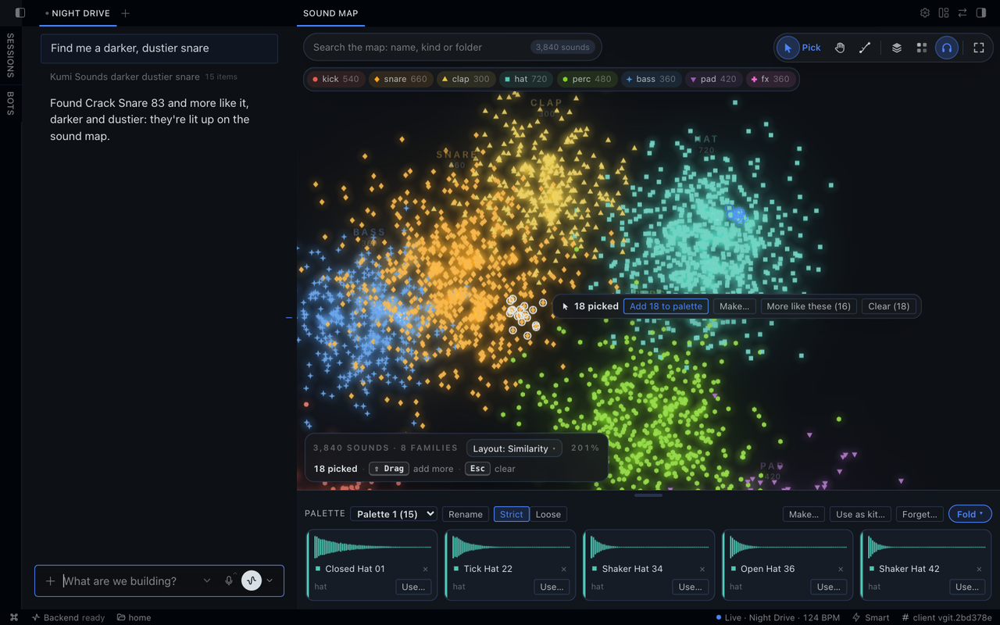
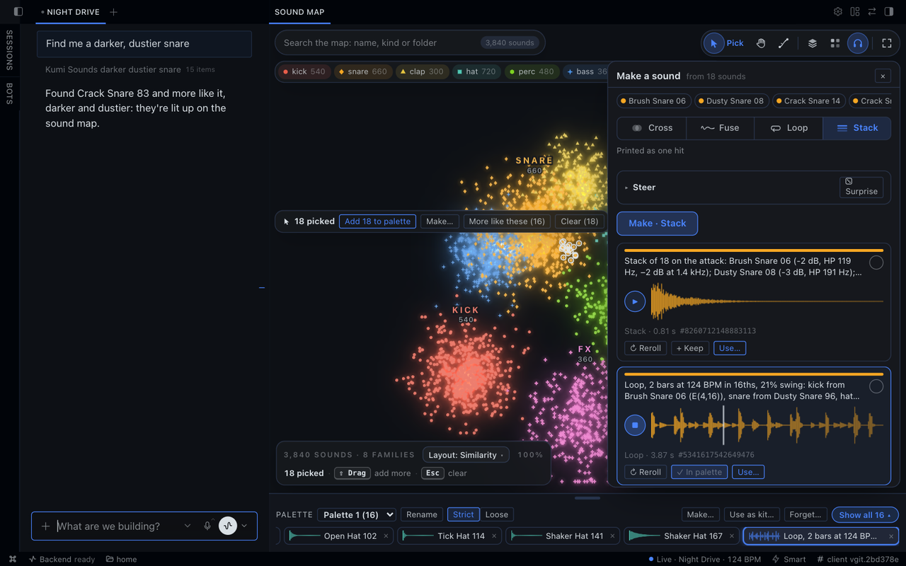
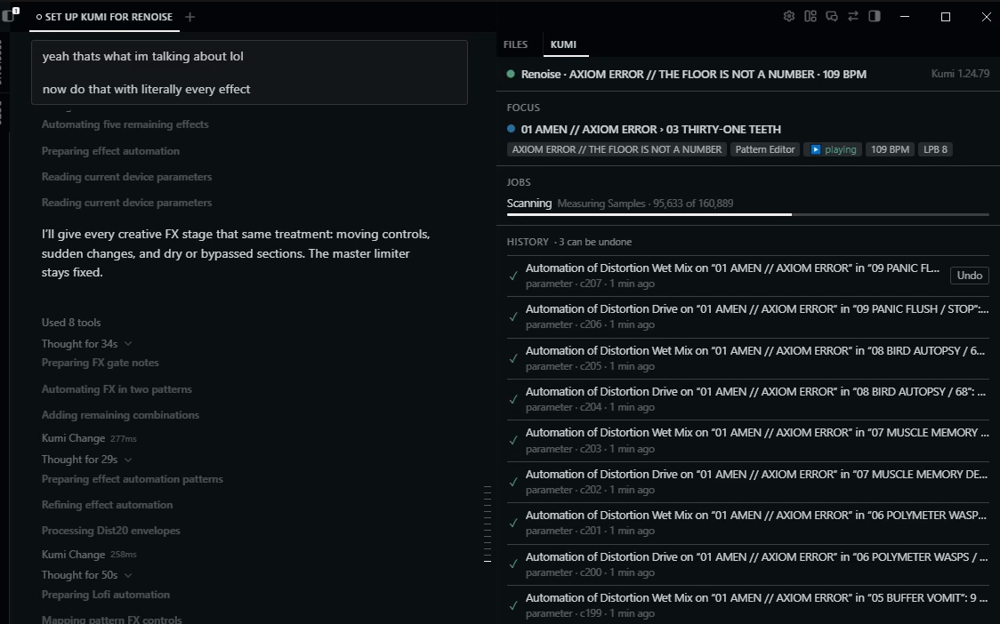
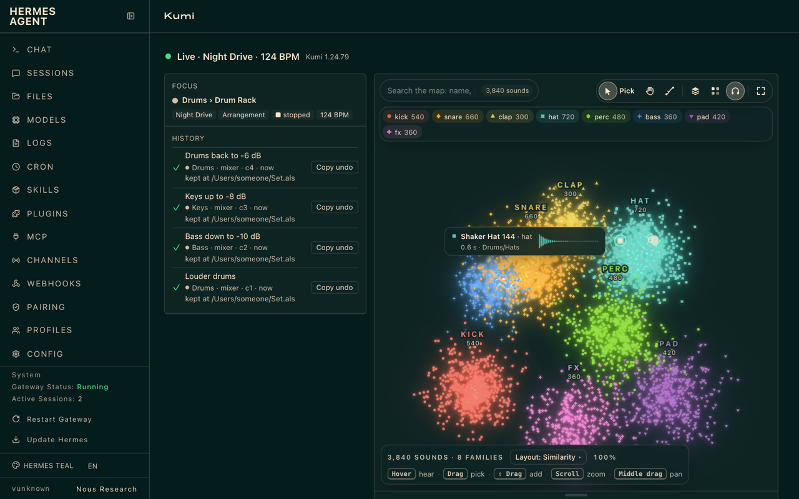

# Kumi for Hermes Agent

[English](../en/HERMES.md) · 简体中文 · [日本語](../ja/HERMES.md)

Kumi 也是 [Hermes Agent](https://hermes-agent.nousresearch.com) 的插件。智能体仍然是 Hermes（终端、Hermes Desktop、网页仪表盘或聊天应用），Kumi 为它接上你的 DAW。Kumi 会直接做出你要求的修改（只有打开 **Ask before each change** 时，Hermes 才会在每次修改前征求你的同意），把每一处修改记入 HISTORY，并能在运行期间撤销其中大部分。两者都在你的电脑上运行。

单独的 Kumi（在终端中使用的 `kumi` 应用）和 Kumi for Hermes 是两套独立的安装，只用其中一个也可以。

## 安装

```sh
hermes plugins install kumi
hermes plugins enable kumi
```

`kumi` 是 Kumi 在 Hermes 插件目录中的名称。在 Kumi 列入目录之前，请从 Kumi 的代码仓库安装：`hermes plugins install user1303836/kumi#hermes-plugin`，然后同样启用它。

在 Hermes Desktop 中，还要在 **技能与工具 → 插件** 里打开 Kumi 的**桌面**开关：插件的桌面开关默认是关闭的。

## 设置

让 Hermes“为 Live 设置 Kumi”（REAPER 或 Renoise 也一样），或在终端运行 `hermes kumi setup --daw reaper`（`--daw` 可取 `ableton`、`reaper` 或 `renoise`；不加时，为 Kumi 设置中的 DAW 进行设置，未更改时是 Live）。设置分两步，另有可选的第三步，每一步之前 Hermes 都会征求你的同意：

1. **Kumi 的运行时：** 从 Kumi 的 GitHub 发布页下载适用于你电脑的 Kumi 官方版本（27–35 MB），用插件固定的 SHA-256 校验，再解压到 Hermes 为这个配置保存的数据中（86–128 MB）。
2. **Kumi 的 DAW 组件：** Live 的 Remote Script（含 Kumi Ears 设备）、REAPER 的扩展或 Renoise 的工具，安装到设置向你展示的确切位置。请先退出 Live：Live 运行时无法安装它的 Remote Script。REAPER 和 Renoise 可以保持打开，装好后重启即可（在 Windows 上更新 REAPER 扩展时，请先退出 REAPER）。
3. **可选的 ffmpeg：** 如果你的电脑上已有 ffmpeg，设置会询问是否让 Kumi 用它读取 MP3、FLAC 等压缩音频。无论是否允许，设置都会完成；不使用时，Kumi 只能读取 WAV 和 AIFF。

Hermes Desktop 会完整显示每一步要你确认的内容。终端里的对话或聊天应用可能只显示其中一部分，所以在那里 Kumi 绝不会只拿出一步的一部分来征求同意，而是请你在终端运行 `hermes kumi setup`，或改用 Hermes Desktop。

然后在 DAW 中：
- **Live：** 在设置 → Link, Tempo & MIDI 中把 **AbletonMcpBridge** 选为控制界面。
- **REAPER：** 重启 REAPER。
- **Renoise：** 启用 Kumi 工具。

**没有 DAW？** 声音地图、调色板和制作声音都不需要 DAW：设置装好 Kumi 的运行时（第一步）后，让 Hermes“把 ~/Samples 加入 Kumi 的音色库并扫描”（任何装有 WAV 或 AIFF 文件的文件夹都可以），然后打开 Hermes Desktop 中声音地图的标签页，或网页仪表盘中的 Kumi 标签页。如果也想试试 DAW 这一侧，REAPER 的免费评估版大约两分钟就能用上：从 [reaper.fm](https://www.reaper.fm/download.php) 安装，然后让 Hermes“为 REAPER 设置 Kumi”。

你最先设置的 DAW 会在同一次确认中成为 Kumi 的 DAW（DAW 设置）。之后再设置另一个 DAW 时，Kumi 仍连接原来的 DAW：设置结束时会告诉你切换的步骤——在终端运行 `hermes kumi setup --daw <daw> --use`，它会在修改设置前征求你的同意。你也可以在 Kumi 的插件设置中更改 DAW（配置文件 config.yaml 中的 `plugins.entries.kumi.settings.daw`）。如果在你的环境中无法写入 Hermes 的设置，设置会说明这一点，以及应该在哪里设置 DAW。

如果这台电脑上的另一套 Kumi（单独的 Kumi，或另一个 Hermes 配置中的 Kumi for Hermes）已经安装了 Kumi 的 Live 组件，设置会告诉你，并建议直接使用那套安装而不是替换它。这样 Kumi for Hermes 会读取那套安装的连接文件，并把自己的连接状态写在那里，但绝不使用它的登录信息或设置。对于 REAPER 和 Renoise，Kumi for Hermes 目前还不能使用另一套 Kumi 的组件：设置会说明这一点，并保持原样。

设置不会启动或退出你的 DAW、替你选择控制界面，也不会保存你的工程。

## 可以让它做什么

### 像参考曲那样为混音做母带

“听听我的混音，按这首参考曲的样子做母带。”
- **聆听：** 在 Live、REAPER 和 Renoise 中，Kumi 会聆听你指定的那部分混音并测量（打开 Ask before each change 时会先征求同意）。在 Live 中，它通过设置安装的 Kumi Ears 设备（需要 Max for Live），在每条音轨的设备之后、推子之前聆听：Main 的设备（包括其限制器）会被听到，Main 的推子不会，所以 Kumi 用 Main 的设备去接近目标，从不动它的推子。
- **比较：** 把你的混音和参考文件放在一起测量：响度、真峰值、频谱平衡、立体声宽度和动态。很宽的立体声和反相的立体声也能准确测量，包括频谱平衡和波峰因数。单声道或无声的文件没有立体声宽度，过短的音频可能没有响度或响度范围：Kumi 会把它们显示为无法测量，而不是猜测。
- **参考的一部分，或多个参考：**“和参考曲从 1:00 开始的 30 秒比较”（最长 60 秒，且在文件范围内），或一次与最多五个参考比较。Kumi 以相同权重把它们测成一个目标及其离散范围，并说明每个测量值来自几个参考。某个参考给不出的值（例如超出其采样率的频段，或单声道文件的立体声宽度）不计入该值，并说明原因。离散范围包含最小容差，并不是置信度。没有单一的“更好”分数、没有平均后的音频，也没有真峰值目标；母带处理仍由 Kumi 提出、由你决定。Kumi 保留的片段从它自己的开头播放。
- **做母带：** 它会在总线（master）轨道上提出母带处理（EQ、粘合压缩、限制器），作为一次修改。
- **重复：** 它会再聆听一次并比较，最多三轮。每一轮的修改都记入 HISTORY，可以撤销。

### 写一段节拍或贝斯线

“在新音轨上写一个四拍底鼓加反拍踩镲”，然后“在下面加一条 A 小调的贝斯线”。
- Kumi 把音符作为一次修改写入。
- “播放”会开始播放；“停止”会停止播放。两者都不会改变工程中的任何内容，只会改变播放的起点。REAPER 从某个小节或拍开始播放，Renoise 从某个序列位置和行开始。在 Live 中，Kumi 会启动某个 Session 片段（例如它写入的，或你选中的那个）或某个场景，或从 Live 自己的开始标记播放 Arrangement。Kumi 绝不会开始一次会录音的播放。
- “做三个变奏：更密的、更稀的，以及一个摇摆感更强的。”每个版本在你保留前 Hermes 都会展示；每个版本都写成一个新片段（REAPER 中是 item，Renoise 中是 pattern），绝不覆盖原来的。最多 8 个版本。如果没有足够的空位放下每个版本，Kumi 会拒绝，而不是少做几个。要舍弃某个版本，撤销它即可。

### 找一个采样并用上

“帮我找一个带颗粒感、偏暗的军鼓。”
- 在你列出的采样文件夹中，按测得的声音特征和文件名、文件夹名中的词查找。在 Hermes Desktop 中会打开声音地图。
- 也可以按速度、调、长度或类型来找：“A 小调、120 BPM 的鼓 loop”“短于 300 ms 的偏暗底鼓”。每个结果都会说明它为什么匹配、依据是什么：Kumi 在该文件夹最近一次扫描时记录的速度、调或音高（来自音频本身，或来自文件名、文件夹名；重新扫描会更新），或者它测得的特征（“暗”“亮”“颗粒感”“lo-fi”“有冲击力”）。速度匹配同一速度或其半速、倍速，调匹配同一个调、它的关系大小调，或 one-shot 的根音；回答会说明是哪一种，而且不会移调。没有记录速度或调的声音，按这个条件找不到。艺人和流派的词只匹配名称和文件夹：Kumi 不会识别流派或艺人。“更多类似的”按在这张地图上你的声音中与那个声音的接近程度排序，绝不以百分比表示。在 Hermes Desktop 中，地图的列表会显示每个声音记录的数值，以及它匹配的原因。选中多个声音时，**更多类似这些的（N）** 会一次请求与它们全部类似的声音（最多 16 个）；Kumi 找到的声音会在地图上亮起，用 **选择全部** 即可选中它们。
- “把它用在军鼓上”：在 Live 中放进军鼓的 Simpler（包括 Drum Rack 打击垫上的），在 REAPER 中放到一条新音轨上，在 Renoise 中放进一个新乐器，作为一次修改。“把它放到一条新音轨上”：在 Live 中放进新音轨上的一个新 Simpler。
- “把它放到打击垫 2 上”：在 Live 中放到那个 Drum Rack 打击垫上——放进该打击垫的 Simpler，或放到空打击垫上的一个新 Simpler 中，每次修改一个打击垫。Kumi 无法撤销加载到空打击垫上的操作，并会事先说明：Live 的撤销通常分两步恢复，所以请立即一次按一下 Cmd+Z，打击垫一空就停下。Live 的重做不会把采样带回来：请让 Kumi 重新加载。Kumi 绝不会为了腾出位置而清空打击垫。在 Hermes Desktop 中，地图的 **Use on pad…** 会把这个请求放进对话。
- 地图上声音的 **使用…** 只把它的引用放进对话：名称和 ID（“Rim Brixton” (sound … from map …)），由你来说要怎么用它；仪表盘中复制同样的文字。
- **地图** 铺满整个窗格，搜索、工具和分组浮在它上面，每个分组有自己的颜色和形状。指针一移到哪个声音上就会立即播放它（前两秒；**悬停播放** 可以关闭），点击哪个声音也会在窗口中播放它（包括 AIFF），DAW 中不会有任何改动。点击的声音会在地图底部的播放器里打开：它的波形、类别、长度和文件夹，以及可以对它做的事。文件已不在、或窗口无法播放的声音会安静地从地图上淡出，一行文字会统计它们的数量：**显示它们** 把它们放回，**重新扫描…** 把重新扫描采样文件夹的请求放进对话（在仪表盘中则复制这个请求）。**方块** 把地图变成各分组颜色的方块，每个声音占一个方块，靠近它原来的位置；圆点会变成方块，也能变回来。**全图** 或双击可以显示整张地图。
- **布局：** **布局** 用另一种方式排列地图，声音会移动到新的位置：**相似度**（听起来相似的声音挨在一起）、**性格**（从暗到亮，从有冲击力到柔和）、**质感**（从有音高到噪声，从高到低）、**调性**（沿五度圈排列）、**速度**（按 BPM）、**类别**（每个类别一座岛）、**长度**（从最短的声音向外的一条螺旋）或 **文件夹**（每个顶层文件夹一座岛）。每种布局都会在地图上写出自己的标签。
- **读懂地图：** 每个类别在它的声音下方发出自己颜色的光，上方写着类别的名称和数量；放大后，有空位的地方声音会显示自己的名称。正在播放的声音会随响度跳动。指针下的声音会显示一个标签（长度和文件夹），并用细线连到离它最近的五个声音；播放时指针在它上面稍作停留，标签里还会出现波形。打开 **悬停播放** 时，指针会留下一道轨迹，颜色来自它播放过的声音。拖出选框时，框边会显示框里有多少个声音。切换布局时，声音会成群地飞向新的位置。Kumi 制作的声音会带上它来源类别的颜色，卡片和波形都是；把指针移到它上面，地图会圈出它的来源声音。在调色板里，这两样要等窗口知道它的来源之后才会显示：它是在这个窗口里制作的，或者已经打开过一次 **制作…**。左下角写着地图里有多少声音和类别、当前布局（一个可以打开布局列表的按钮）、缩放比例，以及此刻指针和按键能做什么；一开始它还会列出三个步骤（听一个声音、拖出一个框、按 **制作…**），每做完一个就消失，也可以按 **跳过** 全部隐藏。如果系统设置了减弱动态效果，地图会保持安静：没有轨迹，没有成群的飞行，正在播放的声音只用圆环标出，不再跳动。
- **在地图上选择和移动：** 拖出一个框即可选中框里的声音，按住 Shift 拖动可再加一个框；按住 Command 或 Ctrl 点击可选中或取消一个声音，按住 Shift 点击可追加一个。对选中的声音能做的事会浮在它们旁边。用中键拖动可以移动地图，打开 **移动地图** 后拖动也可以（在网页仪表盘中，按住空格拖动也可以）。鼠标滚轮缩放；触控板上双指滚动移动地图，双指捏合缩放。按 **Esc**、点击地图空白处或 **清除（N）** 即可取消选择。

### 你的调色板

调色板是你收集起来准备使用的声音，和 Kumi 自己的地图一样；Hermes 读写的也是同一个调色板。



*Hermes Desktop 中的 Kumi 1.24.79；这张 3,840 个声音的地图及其采样是生成的测试数据。*

- **收集：** 在地图上拖出一个框（按住 Shift 可再加一个框），按住 Command 或 Ctrl 点击一个声音可选中或取消它，或用 **选择全部** 选中搜索或 Kumi 找到的声音；然后按 **加入调色板**。选中的声音自己的 **加入调色板** 只加入它。调色板中的声音在地图上带一个圆环。
- **在地图下方**，调色板是一个卡片抽屉：每个声音的波形（与它所在分组同色）、名称和类别、**使用…**（把它的引用放进对话；仪表盘中则复制）和用来移出的 ×。点击播放，拖动（或按 Alt 加 ← / →）移动它。**收起** 只留一行小块（**全部显示** 再次打开），拖动抽屉的边缘可以调整它的高度。可以重命名调色板、新建、切换或删除调色板；删除后声音仍留在你的音色库中。
- **严格或宽松：** 严格时，你要用调色板，Kumi 只用这些声音；宽松时，它也可能推荐每个声音最接近的 5 个，加入前会先问你。
- **用作套件…** 会把“Load the sounds in my palette “…” as a kit”放进对话。在 Live 中，Kumi 随后把它们从 C1 起依次载入 Drum Rack 的空打击垫，每次修改一个打击垫（Live 的撤销可以逐个撤回）。
- **问 Hermes：**“把这些底鼓加入我的调色板”“我的调色板里有什么？”“把我的调色板设为宽松”“把我的调色板作为套件载入”。打开 **告诉智能体我在看什么** 时，Kumi 给对话的说明会写出你的调色板。
- 调色板保存在这个 Hermes 配置中，与单独的 Kumi 的调色板分开。

### 制作声音

Kumi 能用你选中的任意数量（两个或更多）的声音（地图上的声音、调色板里的声音，或 Kumi 之前做的声音）做出一个新声音。你的工程不会有任何改变：在你使用之前，结果只是 Kumi 自己的副本。



*Hermes Desktop 中的 Kumi 1.24.79；采样是生成的测试数据，做出的声音来自 Kumi 的引擎。*

- **交叉**（cross）成一个声音：
  - **融合**（blend）：把它们全部揉成一个声音主体；
  - **起音**（attack）：把一个声音的起音接到其他声音的主体上；
  - **共鸣**（resonate）：一部分声音在另一部分里鸣响，像在它们内部敲击；可以选择谁通过谁鸣响（一半对一半、按选取顺序、隔一个、亮的通过暗的、击打通过有音高的、一个通过全部、串联），以及鸣响的方式和长短；
  - **调制**（modulate）：用其他声音塑造一个声音；可以选择塑造哪个声音、用哪些方式（相位、环形调制、AM、FM、滤波、增益、频谱）以及几级，配方会写出每一级。
- **熔合**（fuse）成更长的东西：
  - **纹理**（texture）：在它们之间漂移、可以循环的铺底；
  - **循环**（loop）：用它们的击打做节拍，或把它们重新定音做成旋律，1 到 8 小节，任意拍号（7/8、6/8……），使用工程的速度。节拍可以用摇摆、密度、每种鼓的繁忙程度、鬼音、加花、滚奏、开镲，以及击打集中在开头还是结尾来引导；旋律可以用调、音阶（从五声音阶到佩罗格）、律制（19、24、31 平均律、纯律、Bohlen–Pierce 等）、偏离音阶的音、和弦、滑音和持续的根音来引导；
  - **涂抹**（smear）：拉长 4 到 16 倍，带一条长而柔和的尾音。
- **叠加**（stack）：把它们按起音对齐、平衡后叠成一个击打。
- **生长**（grow）：让一个声音朝另一个声音生长：从完全像第一个到完全像第二个，中间的声音都是新的。一个种子是一条路径；换一个种子就是另一条。在地图上，**生长** 把它画成一条藤蔓：点击一个声音，再点击要长向的声音（或选中两个后按 **在两者之间生长**），Kumi 每做好一个，藤蔓上就开出一个花苞。点击花苞可以试听，拖动手柄可以生长中间的任意一点；喜欢的可以 **保留**、**使用…**、**制作…** 或 **从这里生长**，**换一条路径** 会用新的种子重新长出藤蔓。
- **引导：** 任何做法都可以在制作前先引导方向。对结果：更暗或更亮、更薄或更厚、滤波、更有音高或更嘈杂、更柔和或更有冲击力、更短或更长、过载、低保真、宽度和空间；对每个声音：音高范围、倒放的几率、起始位置、延迟、声像和电平，每个声音各自抽取。
- **重掷：** 每个结果都有一个种子。换一个种子就是同一配方的另一个版本；同一个种子会再做出完全相同的声音。每个结果都附一行配方，说明用了什么。
- **保留：** 把结果放进调色板，它就会一直留着（否则 Kumi 保留你最新的 200 个结果）。
- **使用…：** 只把结果的引用放进对话：名称和 ID（“Smear of 8 at 9.8×…, seed …” (artifact …)），由你来说要怎么用它；把它放到打击垫或轨道上是一次单独的修改，和你的其他修改一样会先询问。
- **在 Desktop 或网页仪表盘的声音地图上：** 选中声音（或打开你的调色板），按 **制作…**（在 Desktop 中，地图够宽时面板会在旁边打开，放得下时地图会移到它旁边；在网页仪表盘中，面板在地图下方打开），先选 **交叉**、**熔合**、**循环** 或 **叠加**，再选一种做法。设定它的选项，或保持 **自动**（由种子决定，所以 **重掷** 会改变它）：共鸣可选谁通过谁鸣响、鸣响的部分和鸣响时长；调制可选被播放和塑形的声音、可用的调制级、级数和重触发；**循环** 标签页可选 **节拍** 或 **旋律**、速度（在你调整之前跟随工程速度）、小节，以及 **节奏**、**声部**、**律动**、**和声** 和 **线条**。**引导** 可以塑造任何一种做法（**随机惊喜** 随机推动几个控件，**重置** 把它们放回；每种做法各自保留引导设置）。按 **制作**：新声音做好就会播放（按 ▶ 或它的波形可以再听一次），调制的结果会把它的各级排成一行显示。每个结果都有 **重掷**、**保留** 和 **使用…**（仪表盘中改为复制“使用”的文字），‹ › 可以切换一个结果的各个变体，重新载入后结果仍在。保留的声音会飞进你的调色板。选中结果（✓）后按 **用这些制作** 或 **加入素材**，就能用做出的声音继续制作，一代接一代；按 **返回** 回到之前的声音。
- **问 Hermes：**“把这三个底鼓融合起来”“用我的调色板做一段纹理”“把这个军鼓和那个拍手叠起来”“重掷一下”“把第二个放进我的调色板”“把它载入打击垫 C2”。

### 日常操作

- “我现在在看什么？”Kumi 读取你选中的音轨、设备和片段。
- “这个 Serum 上的 Drive 是做什么的？”在 Live 中，Kumi 会读取它对该插件的指南，以及你为它配置（Configure）的参数；在任何 DAW 中，都能读取它的插件格式目录，以及它已验证过的控件。它只读取：不会扫描你已安装的插件，不会按下 Configure，也不会写入预设、调音或波表。Kumi 只是见过的数值范围，并不是它保证的范围。
- “做一个温暖的 Serum 2 铺底音色。”在 Live 中，Kumi 的做法和它单独运行时一样：用 Kumi 验证过的控件（Serum 2 的振荡器、齐奏、滤波器、包络、LFO 速率、宏，以及调制矩阵路由，例如以指定深度把 LFO 1 接到滤波器截止频率）把音色做成预设（见下文），并按名称、照着它的配方转动插件已配置的旋钮。Live 只让 Kumi 转动设备中已配置（Configure）的旋钮，所以要转更多时，它会打开插件的窗口，请你点击 Configure 并把那些旋钮动一下。
- “把贝斯调低 3 dB。”Kumi 做出修改，准确告诉你改了什么，并记入 HISTORY。
- “把贝斯的输出送到 Drum Bus。”Kumi 为音轨设置输出去向。在 Live 中，它不会更改音轨的输入、让音轨预备录音或更改其监听设置：这些是用于录音的。
- “在 keys 音轨的 Instrument Rack 中添加一条链。”在 Live 中，给机架添加链是只能用 Live 自己的撤销来恢复的修改（见[限制](#限制)）。
- “比较这两个导出的文件。”Kumi 测量两个文件：响度、真峰值、频谱。
- “停止扫描。”对采样文件夹的长时间扫描，你一说就会停止。你原来的声音地图会保留，除非扫描已经开始保存新的地图。
- “撤销刚才那个。”Kumi 撤销你在这个对话中最新的一次修改，包括其中每一步，并列出这些步骤。“撤销军鼓那次修改”则在还能撤销时撤销那一条。
- “按这个教程做出贝斯：<YouTube 链接>。”Hermes 读取视频的文字稿；数值只出现在画面上时，它会在浏览器里查看那些时刻（或请你截图），然后 Kumi 用类型化的修改把它做出来。Kumi 不会下载视频。

Kumi 也能与 ElevenLabs 和 Mirelo 的声音配合使用：见[集成](#集成可选)。

### 脚本和 Max for Live 设备

当 Kumi 已知的修改都不合适时，Hermes 可以为它编写代码。
- **脚本：**“在 Renoise 中写一个 Lua 脚本，把每隔一个的 pattern 反转。”Live 中用 Python，REAPER 和 Renoise 中用 Lua。征求同意时，批准会显示 Hermes 所说的用途、开头几行、大小和 SHA-256，以及完整脚本保存的位置；Hermes Desktop 会显示全部代码。脚本以你的 DAW 对电脑的访问权限运行，Kumi 会在 10 秒后（Renoise 中为 0.8 秒）停止它。Kumi 无法撤销脚本：DAW 自己的撤销也许可以。HISTORY 会保留代码，用其中的 **Show code** 可以再次查看。
- **Max for Live 音频效果器：**“做一个带 drive 和 tone 的 Max for Live 软削波器，放在贝斯的 EQ 后面。”Kumi 用 GenExpr 代码写出一个新设备，放到 `User Library/Kumi/Audio Effects`，最多有 16 个自己的控件，另加 Mix 和 Output。它加入的声音保持在 −0.3 dBFS 以下；音轨本身的信号原样通过。征求同意时，Hermes Desktop 会显示它的控件和代码。把它放进你的 Set 是另一次修改：Kumi 把它加载到音轨链的末尾，并且可以撤销这一步。再把它从那里移走是第三次修改，只能用 Live 自己的撤销来恢复。撤销之后，这个文件仍留在你的用户库中。
- **对话读取过外部内容后，每次都会询问：** 网页、文字稿、Hermes 从互联网获取的文件、其他插件的结果，或运行过的任何终端命令或代码。已在你磁盘上的文件、已安装的技能，以及你的音色库和工程中的名称不算在内。在这样的对话中，每个脚本和设备都会带着代码征求同意，Hermes 的确认关闭时一个也不会运行。在没有读取过外部内容的对话中，除非打开了 Ask before each change，脚本会直接运行，设备会直接构建；打开时，在本次会话中允许一个脚本，就对这个对话中的脚本都有效。
- **在询问任何人之前就会拒绝：** 超过 400 行或 32 KB 的脚本或设备代码；含有隐藏字符或改变文字方向字符的脚本，或会运行进程、访问网络的脚本（`os.execute`、`io.popen`、`subprocess`、`os.system`、`socket`、`urllib`、`ctypes`）。这项检查是一道保护措施，不是沙盒。

### 插件预设（Live）

“做一个削掉 300 Hz 附近浑浊感的 Pro-Q 4 预设。”在 Live 中，Kumi 会为 Serum 2（2.1.5）、Pro-Q 4（4.1.3.0）或 Ozone 12（12.1.0）制作一个新预设，只针对你已安装的版本：从插件的初始设置开始，用和 Kumi 本身相同的预设写入器，最多改动 512 个 Kumi 验证过的控件。
- **制作本身不会改变任何东西：** Kumi 保留一份私有副本，并按预设文件存储的方式说明每个设置改动前后的值。
- **放进你的用户库**（打开 Ask before each change 时会先征求同意）：会显示插件和已安装的版本、每个设置、“Values as the preset file stores them; the plug-in may show them differently.”，以及位于 `User Library/Kumi/Instruments` 或 `User Library/Kumi/Audio Effects` 的新文件。撤销之后文件仍会保留。在本次会话中或始终允许一个预设，只对那一个文件有效：每个新预设都会征求同意。
- **把它加载到音轨上是另一次修改。**
- 制作预设时，Kumi 绝不会打开你自己的预设、运行插件或下载任何东西。未安装的插件，或已安装版本未经 Kumi 验证的插件，会被拒绝。

### 评判回合和波表（Live）

“把它做到 −14 LUFS，峰值上限 −1 dB。”Kumi 按回合（`kumi_judge`）朝响度、真峰值或参考曲的平衡靠近：它聆听那一段，列出差距，每次你做出修改后，只有变好了才保留，否则自己撤回。`kumi_tune` 让 Kumi 在这样的回合中为设备挑选数值。每个回合都是 HISTORY 中可以撤销的一次修改；Live 停止时，Live 经由 Kumi Ears 播放那一段，之后恢复原样（打开 Ask before each change 时会先征求同意）。对于 Serum 2 或 Vital，`kumi_wavetable` 会写入一个新的波表文件，然后由你在插件窗口中选择；撤销后它仍会保留。

### 声音、试听、律动、渲染和歌曲结构（Live）

“底鼓和贝斯配合得怎么样？”`kumi_sound` 在一遍中把最多 8 条音轨并排聆听并测量：每个声音的包络、音色、效果（混响时间、回声、泵感）、问题、作为鼓组的判断，以及谁在谁下面闪避。“这三个 pad 里哪个最接近参考？”`kumi_audition` 把那一段播放一次，把最多 8 条候选音轨与参考（Set 中的片段、声音、Kumi 生成的文件或已批准的文件，最多 60 秒）比较并打分。两者都在 Live 停止时经由 Kumi Ears 播放（每一遍最多 60 秒，包括之前的一小节和之后的半小节），之后全部恢复原样（打开 Ask before each change 时会先征求同意）。“让我的踩镲像这个 loop 一样摇摆。”`kumi_groove` 不聆听，而是在音符上让 MIDI 段落的律动靠近参考 MIDI 片段；`apply` 移动音符，是可以撤销的修改。`kumi_render` 离线渲染音频音轨自身片段最多 60 秒，并保留文件供 `kumi_listen` 使用。“副歌第一次在哪里出现？第二段主歌是不是拖沓？”`kumi_form` 在你等待时把整个 Arrangement 播放一次（按 Hermes 默认的工具时限最多约 6 分半，调高 `timeouts.tools.sequential_call` 后最多 15 分钟；更长的歌曲分段读取；按 Stop 即结束），逐小节读出：整首歌的能量、段落、转折、第一个 hook，以及哪些音轨在哪里出现；如果你给出参考，还会把参考的结构并排列出。

**哪些会先征求同意。** 默认情况下，Kumi 会不经询问直接做出修改、撤销、对音轨或混音的聆听、播放、变奏版本、预设，以及在没有读取过外部内容的对话中运行脚本和构建设备：每一项都记入 HISTORY，大部分可以撤销。设置步骤、采样文件夹的添加与扫描、Mirelo 的上传和付费生成，以及在读取过外部内容的对话中的脚本和设备，始终会征求同意。在 Hermes 中 Kumi 的设置里打开 **Ask before each change**（插件配置中的 `ask_before_changes`），Hermes 就会在每一项之前按修改类别、按对话征求同意。Kumi 从不在 Hermes 中自动批准任何东西。`/kumi`、`hermes kumi status` 和 `hermes kumi doctor` 会说明当前是哪种情况，例如“Approvals: Kumi makes your changes and runs your scripts without asking (Ask before each change: off); setup steps, sample folders and Mirelo jobs still ask”。

在本次会话中或始终允许某个 Kumi 调用，只对这个对话中的同类调用有效，也包括恢复该对话的一次性运行（`hermes chat -q --resume`）；另一个对话、新的一次性运行或定时任务，会重新询问或被拒绝。定时任务和 Webhook 从不修改任何东西。新的一次性 `hermes chat -q` 运行则可以修改：Hermes 在它的网关中运行它的工具，Kumi 无法把它与对话区分开，所以默认情况下它会像对话一样做出所要求的修改、运行所要求的脚本。打开 Ask before each change 时，由于没有人能回答，Hermes 会在那里拒绝这些修改；设置步骤、采样文件夹和 Mirelo 任务在那里无论开关都会被拒绝。Kumi 只在你自己的回合中行动：Hermes 在后台处理对话（每轮之后的回顾）或回答旁支问题（`/btw`）时，无论你允许了什么，Kumi 都只读取。打开 Ask before each change 时，只能用 DAW 自己的撤销来恢复的修改，会作为单独的一类征求同意，所以允许其他修改并不包括它。设置步骤的批准只针对它自己的计划。选择**始终允许**会在 Hermes 的 `command_allowlist`（你的配置中的 config.yaml）里留下一条记录，Kumi 从不编辑它：要取消，请删除其中以 `plugin_rule:kumi:` 开头的条目。

使用 `--yolo`、对话中的 `/yolo` 或 `approvals.mode: off` 时，Hermes 会不经询问直接执行 Kumi 的修改、撤销、聆听、播放、采样文件夹的添加与扫描、设置步骤，以及设置了 Mirelo 时它的付费生成和上传（以你的点数上限为限）。脚本和设备在那里也会不经询问运行，但只限于没有读取过外部内容的对话：读取过的对话中，它们会被拒绝。`/kumi` 会说明这一点。如果 `approvals.single_query_mode` 或 `delegation.subagent_auto_approve` 让修改不经询问就通过，`hermes kumi status` 也会说明。一次性的 `hermes -z` 也等同于 yolo：Kumi 的调用会不经询问直接执行，而且 Kumi 无法把它与普通对话区分开。

## 东西在哪里

- **所有界面：** Kumi 的工具、技能（`kumi:daw`、`kumi:sounds`、`kumi:listening`，以及用于 Mirelo 的 `kumi:generate`）以及查看状态的 `/kumi`。在消息中写 `@kumi:focus`、`@kumi:history` 或 `@kumi:status`，即可附上 Kumi 最后看到的内容。
- **Hermes Desktop：** 状态标签、显示 FOCUS 和 HISTORY 的侧边栏、单独标签页中的声音地图（下方是你的调色板）、测量结果卡片和 Hermes 命令面板中的命令。脚本或设备等待你批准时，侧边栏会显示它的全部代码（以及设备的控件）；脚本在 HISTORY 中的那一条有 **Show code**。按钮只会把请求放进对话，不会自己修改你的工程。
- **网页仪表盘：** 一个包含 HISTORY、状态、地图和调色板的 Kumi 标签页。
- **Kumi 状态旁的圆点**（状态标签、侧边栏和仪表盘里）在 DAW 播放时按工程的速度跳动，停止时保持不动。





截图：面板是真实 Ableton Live 12 上的 Kumi 1.24.73。地图、调色板、制作和仪表盘的截图是 Kumi 1.24.79，运行在生成的 3,840 个声音的测试地图上，做出的声音来自 Kumi 的声音设计引擎。对话中 Hermes 一方来自按脚本回答的替代模型，文字仅作示意；Kumi 一方是真实的。

## 设置项

| 设置 | 默认 | 作用 |
|---|---|---|
| DAW | Live | Kumi 连接哪个 DAW。你最先设置的 DAW 会成为它；用 `hermes kumi setup --daw <daw> --use` 切换（`ableton`、`reaper` 或 `renoise`） |
| 采样文件夹 | 无 | 为声音地图允许 Kumi 读取的文件夹：扫描只读取其中的音频文件，其他内容一概不扫描。不能是整个磁盘或卷、你的主文件夹或它上面的文件夹，也不能在 Hermes 自己的文件夹（`HERMES_HOME`）之内或之上；可以用 `~/`。链接和联接点绝不会把 Kumi 带出你列出的文件夹；在 Windows 上，Kumi 会跳过云端占位文件（例如 OneDrive 的） |
| 告诉智能体我在看什么 | 开 | 当你查看的内容变化时，在连接 Kumi 的对话中加入一段简短说明：你正在看什么（FOCUS），以及 Kumi 不在时工程里有哪些变化 |
| Ask before each change | 关 | Hermes 会在 Kumi 的每次修改、撤销、对音轨或混音的聆听、播放、变奏版本、预设、脚本和设备之前，按修改类别、按对话征求同意。关闭时，Kumi 不经询问直接执行，并把每一项记入 HISTORY；设置步骤、采样文件夹、Mirelo 任务，以及在读取过外部内容的对话中的脚本和设备，无论开关都会征求同意 |
| 从聊天应用运行脚本 | 关 | 允许聊天应用（Discord、Slack、Telegram 等）中的对话请求在你的 DAW 中运行脚本，或构建 Max for Live 设备。无论 Ask before each change 如何，每一个都会带着代码征求同意，Hermes 的确认关闭时一个也不会运行 |
| 用模型解读测量结果 | 关 | 把测量数值和一张小的频段能量图也发给你在 Hermes 中为 Kumi 聆听任务设置的模型（未更改时为 Vision 的模型），用文字解读；该模型必须能接受图片 |

## 哪些内容会离开你的电脑

- **设置：** 每个 Kumi 版本从 Kumi 的 GitHub 发布页下载一次运行时。
- **对话：** Kumi 记下的工程信息（FOCUS、变化）和测量结果，会作为对话的一部分发给你在 Hermes 中使用的模型。Kumi 的状态告诉模型设置进行到哪一步时，不会提到你电脑上的任何文件夹。
- **用模型解读测量结果**（只有打开后才会）：把测量数值和一张小的频段能量图发给你在 Hermes 中为 Kumi 聆听任务设置的模型，或 Hermes 为该任务配置的后备服务商，绝不发送音频本身或文件路径。重试和后备可能增加时间和 token 费用。
- **音频留在本地：** Kumi 在你的电脑上测量音频，不会把音频发给任何模型。在聊天应用（Telegram、Discord 等）中，如果你让 Hermes 把声音发给你，它会作为附件通过该应用送达。
- **聆听音轨或混音：**
  - **时间范围：** 只聆听你指定的时间范围，最长 60 秒（在 Live 中最多为 Arrangement 中的 256 拍），并且 DAW 必须处于停止状态；打开 Ask before each change 时会先征求同意。Kumi 不会替你停止播放。唯一的例外是读取歌曲结构（`kumi_form`）：它会在你等待时把整个 Arrangement 播放一次（按 Hermes 默认的工具时限最多约 6 分半，调高 `timeouts.tools.sequential_call` 后最多 15 分钟；更长的歌曲分段读取），按 Stop 即结束。
  - **你的工程：** 渲染临时使用的走带、路由和设备设置之后都会恢复。聆听后 REAPER 可能显示工程已修改，因为只有保存才能清除这个标记；Kumi 从不保存。
  - **Renoise 的速度：** 渲染可能改变它的 BPM 和每拍行数。只有它们仍是渲染留下的值时，Kumi 才会改回去；如果已经不同，它会两者都保持原样，并说明无法恢复速度。
  - **音频：** DAW 渲染到 Kumi 在该 DAW 中的组件的聆听文件夹；Kumi 把这一个文件复制到自己的数据中，在那里测量。
  - **Live：** Kumi 在 Live 停止且未录音时，通过 Kumi Ears 采集这段时间范围，结束后移除该设备；之后详细视图会重新显示你之前打开的片段。Live 可能显示 Set 已修改，并且 Live 自己的撤销历史中会留下这次聆听的临时设备步骤：在 Live 中按撤销可能会让 Kumi Ears 回来。这些步骤不是 Kumi 的 HISTORY 中的修改。
- **脚本**以你的 DAW 对电脑的访问权限运行：它读取、写入或发送什么，取决于它的代码。Kumi 会把每个脚本的代码保存在自己的数据中。
- **Max for Live 设备**是 Kumi 写入 Live 用户库（`User Library/Kumi/Audio Effects`）的新文件，位于 Kumi 自己的数据之外。在你删除之前，它们会一直留在那里。
- **插件预设**是你放进用户库后 Kumi 写入 Live 用户库（`User Library/Kumi/Instruments` 或 `User Library/Kumi/Audio Effects`）的新 `.vstpreset` 文件，位于 Kumi 自己的数据之外。在你删除之前，它们会一直留在那里。为了知道你安装的 Serum 2、Pro-Q 4 或 Ozone 12 是哪个版本，Kumi 会读取标准插件文件夹中的 VST3 元数据；它从不加载插件。
- **波表**是 Kumi 写入 Vital 波表文件夹（`~/Music/Vital/User/Wavetables`；Windows 上为 `~/Documents/Vital/User/Wavetables`）或 Live 用户库（`User Library/Kumi/Wavetables`，用于 Serum 2 等）的新 `.wav` 文件（从不覆盖已有文件），位于 Kumi 自己的数据之外。撤销后它们仍会保留。
- **评判回合和调校**会在 Live 中播放那一段：Live 停止且不在录音时，经由设置时安装的 Kumi Ears 设备（放在音轨上或 Main 之前）播放，之后再移除它（这些临时的设备步骤会留在 Live 自己的撤销历史里）。每一遍最多 60 秒，包括 Live 在这一段之前播放的一小节和之后的半小节；如果 Live 开始播放晚了，评判或调校的这一遍可能会在同样的上限内再播放一次。听到的声音在调用结束前留在 Kumi 自己的数据里。测量声音和试听也以同样方式播放；试听 Session 片段时，会在 Arrangement 中制作临时副本来播放，之后删除。律动的 `apply` 以及被撤回的律动回合，会以 HISTORY 中的修改改变 MIDI 片段的音符。渲染会把音轨自身片段最多 60 秒保留在 Kumi 自己的数据里，并删除 Live 的临时渲染文件。读取歌曲结构时，同样会在你等待时把整个 Arrangement 播放一次（不是每遍 1 分钟，而是 Hermes 工具时限允许的长度：默认约 6 分半，调高 `timeouts.tools.sequential_call` 后最多 15 分钟），按 Stop 立即结束。调校的 search 和 probe 会在 Set 中为本轮的音轨制作临时副本，之后删除；如果 Kumi 中途停止，它下次查看（`kumi_observe`）时会删除残留的副本。没有录音过程，也不会下载任何模型：回合依据仪表来判断。
- **项目的副本：** 在某些修改之前，Kumi 会把最后保存的项目复制一份放在它旁边，每个保存的版本只复制一次。未保存的项目不会被复制，Kumi 也从不保存项目本身。
  - Live：当一次修改进行到第三步时（`<Set>.backup-<日期>.als`）。副本会一直保留，直到你删除它。
  - Renoise：在加载采样的修改之前，例如把资料库里的声音放进一个乐器时（`<Song> (Kumi copy <日期>).xrns`）。Kumi 为每首曲子保留最新的 5 份副本，并删除更早的副本。超过 512 MB 的曲子不会被复制。
  - 保留了副本的修改会说明这一点，并给出副本的名称。在 Hermes Desktop 中，它在 HISTORY 中的那一行显示“在此之前，Kumi 在它旁边保留了一份最后保存的项目副本：<文件>”。
- **Mirelo**（只有设置后才会）：见[集成](#集成可选)。
- **定时任务**（Hermes 的 cron）只读取 Kumi 最后发布的状态和 HISTORY。它的回答（修改标题、音轨名称）只会通过该任务的投递目标离开你的电脑；Kumi 的任务模板默认投递到本机。
- Kumi for Hermes 绝不使用单独的 Kumi 的登录、模型服务商或更新程序，也不发送遥测数据。

## 限制

- 你的 DAW 必须运行在运行 Hermes 的那台电脑上。连接到远程 Hermes 的 Hermes Desktop 控制的是那台电脑上的 DAW，而不是你本机的。
- Live 12 支持 macOS 和 Windows。Kumi 在 Live 12.4（测试版）上测试过；Live 12.0 到 12.3 未经测试，且没有运行 Kumi Live 扩展所需的 Extension Host，所以在这些版本上 Kumi 无法离线渲染、把 MIDI 片段写入 Arrangement，也无法清除 Arrangement 中的范围。REAPER 7 及以上和 Renoise 3.5 及以上支持 macOS、Windows 和 Linux。
- Kumi 会聆听你指定的时间范围，最长 60 秒（在 Live 中最多为 Arrangement 中的 256 拍）；在 Live 中读取歌曲结构时，会把整个 Arrangement 播放一次（按 Hermes 默认的工具时限最多约 6 分半，调高 `timeouts.tools.sequential_call` 后最多 15 分钟）。在所有 DAW 中，它都能测量音频文件、音色库中的声音和 Kumi 自己的结果。
- Kumi 只读取打开的工程、你列出的采样文件夹中的音频文件、它对你指定的时间范围的渲染和采集，以及其他 Hermes 插件保存在 Hermes 生成音频文件夹（`<HERMES_HOME>/cache/generated/audio`，Kumi 从不创建这个文件夹）中的已完成音频，用于放置或测量。
- Kumi 能直接读取 WAV 和 AIFF。对于 MP3、FLAC 等压缩音频，如果你在设置时允许，它会使用电脑上已有的 ffmpeg（绝不下载）。每次启动前，Kumi 都会确认它仍是你允许的那个 ffmpeg 文件（不检查它加载的库，这些库可能随升级而变化）。ffmpeg 只会拿到 Kumi 正在读取的那一个文件：绝不是 URL 或播放列表，也不从网络读取任何内容。Kumi 可读取的文件最大 50 MiB，最多测量其中 12 分钟。
- Kumi 的 REAPER 扩展只在连接该 DAW 的单独 Kumi 请求时，才会在已保存的工程中保存一个 ID（Renoise 工具则保存在歌曲中）；Kumi for Hermes 从不请求。一旦保存，这个 ID 会随工程一起保存。
- 在 Windows 上，网络文件夹（`\\server\share`，或通过链接访问的共享文件夹）中的采样无法在 Hermes Desktop 或仪表盘中播放：它们只播放这台电脑本地磁盘上的文件。
- 在 Hermes Desktop 或 Hermes 的终端界面中停止，或在聊天应用中发送 `/stop` 或 `/new`，会取消正在进行的 Kumi 修改、撤销或聆听。之后 Kumi 无法确定它是否已完成，所以再次请求前请先查看 HISTORY。在经典的 `hermes chat` CLI 中，停止不会传到 Kumi：调用会一直运行到完成或达到时间上限。
- Kumi 只能在做出修改的那个 Kumi 运行时仍在运行时撤销该修改。运行时会在对话结束、Hermes 卸载插件或退出，或 15 分钟没有任何操作（为某个对话连接着 DAW 时为 2 小时）后停止。它正在运行任务时（例如音色库扫描），最多会继续运行 6 小时。停止之后修改仍留在 HISTORY 中，但要撤销请使用 DAW 自己的撤销。
- 在 Live 中，有几种修改只能用 Live 自己的撤销来恢复：给机架添加链、移动设备，以及把采样加载到打击垫上。Kumi 会事先说明这一点，以及如何用 Cmd+Z（Windows 上为 Ctrl+Z）恢复，HISTORY 也会标记这一条。请立即撤销：如果你之后在 Live 中做过任何操作，Cmd+Z 会先撤销那些操作。这样的修改不包含其他内容：其他步骤 Kumi 会作为另外的修改来做。脚本在所有 DAW 中都一样：Kumi 无法撤销它，DAW 自己的撤销也许可以。
- 在 Live 中，如果 Kumi 修改了某条音轨的调音台设置、速度或某个设备的参数，而你之后又手动改过这个值，Kumi 不会撤销那次修改：撤销会说明这一点，并且不做任何改动。撤销会列出每个值的当前值，以及撤销后会恢复成的值。在 REAPER 和 Renoise 中，即使你之后手动改过这个值，撤销也会把它改回去。
- 在 REAPER 和 Renoise 中，Kumi 连接期间你手动做的编辑，在你问“有什么变化”时不会被列出；Kumi 下一次查看时仍会看到工程当前的样子。
- Kumi 只在 Live 中制作插件预设，而且只针对 Serum 2（2.1.5）、Pro-Q 4（4.1.3.0）和 Ozone 12（12.1.0）。在 REAPER 和 Renoise 中，它会说明这一点（“Kumi builds plug-in presets only for Ableton Live for now.”），并且不写入任何东西。
- Kumi for Hermes 不会操作 Live 的菜单、录音，也不会保存或打开工程。在 Live 中它不会为音轨编组：请选中它们并按 Cmd+G（Windows 上为 Ctrl+G）。

## 集成（可选）

Kumi 的核心功能不需要其中任何一个。

### 其他 Hermes 插件的声音（ElevenLabs）

“用 ElevenLabs 做一个上升音效，放到 FX 音轨上。”其他 Hermes 插件生成声音后，Kumi 可以测量它，或把它放进你的工程。Kumi 只读取 Hermes 生成音频文件夹（`<HERMES_HOME>/cache/generated/audio`，Kumi 从不创建这个文件夹）中的已完成音频，并先把文件复制到自己的数据中；放置和其他修改一样，是一次修改。

### Mirelo（付费）

“用 Mirelo 做一段黑胶噪声”或“把这段贝斯转成 MIDI。”有 [Mirelo](https://mirelo.ai) 账户时，Kumi 可以请 Mirelo 根据提示词生成音效，或把音频文件转成 MIDI 音符。

- **打开之前不会使用：** 在 Kumi 的设置中添加你的 **Mirelo API key**（作为 Hermes 机密保存，`MIRELO_API_KEY`），打开 **Use Mirelo for paid generation**（使用 Mirelo 付费生成）和你需要的类别（**Mirelo sound effects**（音效）、**Mirelo audio to MIDI**（音频转 MIDI）），并把 **Mirelo credit cap**（点数上限）设为大于 0（默认的 0 会拒绝所有付费生成）。只有密钥时，Kumi 绝不会使用 Mirelo。
- **是点数，不是钱：** 每次生成都会先带着 Mirelo 以 API 点数计的估价征求同意，这次批准只对这个估价有效，且只用一次。为生成 MIDI 而发送音频文件会单独征求同意；在本次会话中允许，也只对那个对话中的那个文件有效。上限按 Kumi 的整个使用期间计算：每次生成最多预留其估价的点数；扣费在 Mirelo 告知之前可能一直未知（期间预留仍计入上限）；扣费超过估价时，新的付费生成会暂停。在定时任务、`hermes chat -q`、Webhook 或 Hermes 的 API 服务器中，不会付费，也不会上传。
- **查看和处理点数（在终端中）：** `hermes kumi credits` 显示已用、预留和剩余的点数，以及尚未结清的预留。`hermes kumi credits unfreeze` 让付费生成重新开始；`hermes kumi credits release <id>` 在你到 Mirelo 的控制台核实后，解除扣费一直未知的预留（如果 Mirelo 之后又告知了这笔扣费，仍会计入，并暂停新的付费生成）。每个命令都会先征求你的同意，而且只能由你执行：Hermes 和它的模型无法运行它们。
- **离开你电脑的内容：** 你的提示词，以及转 MIDI 时你批准的音频文件，会连同你的密钥发送到 `api.mirelo.ai`，以及 Mirelo 的 API 为每个任务给出的上传和下载链接。这些链接的主机由 Mirelo 选择（它的存储或分发网络），并不是一份固定的清单。Mirelo 能否用你发送的内容训练，取决于你的 Mirelo 账户设置；Kumi 自己没有这方面的设置。
- **生成结果**保存在 Kumi 的数据中。放置它是另一次修改，MIDI 音符的时间以秒计。要转成 MIDI 的音频文件需在 Mirelo 的限制之内（30 分钟、50 MiB）；MP3 等压缩音频需要设置时允许的 ffmpeg。关闭某一类会停止该类的新生成（已经在进行的生成，只要密钥还在，仍会取回结果）；删除密钥后，Kumi 不再联系 Mirelo。

### 放进工程的声音

两者的声音放进工程后，都会留在这个配置的 `plugin-data/kumi/` 文件夹中，工程从那里播放它。删除这个文件夹之前，请把这些工程连同文件一起保存（Live：文件菜单中的 **Collect All and Save**；REAPER：**Save project as…** 并勾选 **Copy all media into project directory**），否则这些采样会丢失。

## 遇到问题时

- `hermes kumi doctor`（在对话中用 `/kumi doctor`）会检查 Kumi 在这个 Hermes 配置中需要的一切：Hermes 的批准设置和 Kumi 是否在每次修改前征求同意、设置、连接、打开的项目和声音地图。对每个问题，它都会告诉你该怎么做。它不会更改任何内容。
- `/kumi`（在终端中用 `hermes kumi status`）会告诉你设置还缺什么，以及 Kumi 能否读取压缩音频。当 `plugins.isolation` 为 `host` 时，Hermes 不会加载 `hermes kumi` 这类插件命令，请改在 Hermes Desktop 的对话中设置。
- Hermes Desktop 中看不到 Kumi：检查 技能与工具 → 插件 里 Kumi 的 **Agent** 和**桌面**开关是否打开，以及 Hermes 中是否已启用（`hermes plugins enable kumi`）。
- 网页仪表盘中没有 Kumi 标签页：如果安装 Kumi 时仪表盘已经在运行，请重启它（`hermes dashboard`）。
- Live 连不上：检查是否已把 AbletonMcpBridge 选为控制界面。
- REAPER 没有响应（某个修改显示 “unsure”，或 Kumi 的状态说可能有对话框开着）：REAPER 有一个窗口在等你处理，比如评估版提醒或音频设备的询问。在 REAPER 中关掉它，然后再让 Hermes 试一次。
- 聆听被拒绝，因为 Kumi 在你的 DAW 中的组件版本较旧：重新运行设置以更新它，然后重启 DAW。
- 在 Live 中聆听时提示 Kumi Ears 缺失或不可用：它需要 Max for Live。请重新运行设置；聆听从不安装它。
- 在 Live 中聆听时提示“Live is not following the Arrangement”：在 Live 中按下 Back to Arrangement，然后再试一次。
- 聆听要求你停止播放，或 Renoise 提示“is not ready to render”：停止播放和录音，关闭 Renoise 的 Edit Mode，并等它的速度扫描完成。Kumi 不会替你停止播放或录音。
- “播放”在 DAW 正在录音或录音开启时被拒绝：Kumi 绝不会开始一次会录音的播放。请先在 DAW 中关闭录音。
