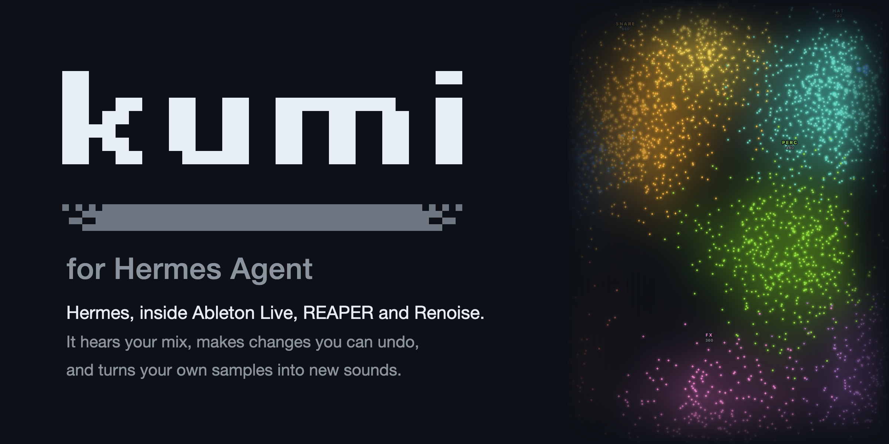

# Kumi for Hermes



**Drive Ableton Live, REAPER and Renoise from Hermes.** Kumi reads the project you have open, makes typed changes
in it after you approve each one, records every change in an undoable HISTORY, measures audio on your computer, and
maps the sample folders you choose so you can find, audition and place sounds. Hermes stays the agent: Kumi gives it
a DAW to work in.

- **Ask in plain words, from any Hermes surface.** "Put a darker snare on pad 2", "bring the bass up 2 dB",
  "undo the snare change". The TUI, Hermes Desktop, the web dashboard and messaging all use the same tools.
- **Every change is approved and reversible.** Hermes asks before Kumi changes your project, shows exactly what will
  change, and Kumi records the result in its HISTORY, with undo while the Kumi runtime that made the change is running.
- **Kumi knows what you're looking at.** When what you've selected changes, the chat connected to Kumi gets a short
  note of the track, device and clip (FOCUS), and what changed since Kumi last looked.
- **Your own sounds, on a map.** Kumi learns the sample folders you list and lays them out by how they sound; in
  Hermes Desktop the map opens in its own tab, where a click auditions a sound and "Use" asks Hermes to place it.
- **Measured, not imagined.** Loudness, true peak, loudness range, spectrum and tempo are measured on your
  computer. Kumi never claims to have heard what it hasn't measured.

## Tools

| Tool | What it does | Asks first |
|---|---|---|
| `kumi_status` | Setup, runtime and DAW connection state | no |
| `kumi_setup` | Plans and installs Kumi's runtime and its part in your DAW | yes, each step |
| `kumi_connect` | Starts Kumi and connects to the DAW chosen in settings | no (changes nothing in your project) |
| `kumi_observe` | A short, current look at the project: FOCUS, what changed, the project overview | no |
| `kumi_read` | Bounded reads of tracks, devices, clips and their settings | no |
| `kumi_change` | One typed change of one or more steps, recorded in HISTORY | yes |
| `kumi_undo` | Undoes a HISTORY entry while it can still be undone | yes |
| `kumi_history` | Lists recent changes and whether each can be undone | no |
| `kumi_listen` | Measures an audio file, a library sound, a result Kumi made, or a track or the mix | for a track or the mix |
| `kumi_sounds` | Searches your sound library | no |
| `kumi_library` | Adds a sample folder and scans it | yes |
| `kumi_job` | Reports a long job (a library scan) | no |

Three skills teach Hermes how to use them well: `kumi:daw`, `kumi:sounds` and `kumi:listening`. In any message, write
`@kumi:focus`, `@kumi:history` or `@kumi:status` to attach what Kumi last saw: what you're on in the DAW, its recent
changes, or its connection. They only read what Kumi has already published, so nothing asks first.

## Install

```sh
hermes plugins install kumi
hermes plugins enable kumi
```

In Hermes Desktop, also turn on Kumi's **Desktop** switch under **Capabilities → Plugins**: a plugin's Desktop switch
starts off.

## Set up

Kumi needs two things on the machine that runs Hermes, can use a third, and asks before each:

1. **Its runtime:** Kumi's official release for your platform, 26–33 MB, from
   `github.com/user1303836/kumi/releases/download/v<version>/`. Kumi checks it against the SHA-256 this plugin pins,
   unpacks it (82–120 MB) into this profile's plugin data, and refuses anything that doesn't match.
2. **Its part in your DAW:** Live's Remote Script (with the Kumi Ears device), REAPER's extension or Renoise's tool,
   installed only at the location shown to you. Quit Live first; REAPER and Renoise can stay open and restart after.
   If another Kumi on this computer (a standalone Kumi, or Kumi for Hermes in another Hermes profile) already put its
   part in Live, setup offers to use that installation instead of replacing it; for REAPER and Renoise, Kumi for Hermes
   can't use another Kumi's part yet. The first DAW you set up becomes
   Kumi's `daw` in the same approval; setting up another one keeps the current DAW and ends with the step that
   switches: `hermes kumi setup --daw <daw> --use`, approved like the rest.
3. **Optional, ffmpeg:** if an ffmpeg is already on this computer, setup offers to let Kumi's runtime run it to read
   MP3, FLAC and other compressed audio. Setup is done either way; without it, Kumi reads WAV and AIFF only.

Ask Hermes to "set up Kumi for Live" from any surface, or run `hermes kumi setup` in a terminal. Then, in the DAW:

- **Live:** choose **AbletonMcpBridge** as a Control Surface in Settings → Link, Tempo & MIDI.
- **REAPER:** restart REAPER.
- **Renoise:** enable the Kumi tool.

Setup never starts or quits your DAW, picks a Control Surface for you, or saves a project.

## Settings

Set them in `plugins.entries.kumi.settings` in this profile's `config.yaml`, or where Hermes Desktop shows the plugin's
settings:

| Setting | Default | What it does |
|---|---|---|
| `daw` | Live (`ableton`) | Which DAW Kumi connects to. The first DAW you set up becomes it; `hermes kumi setup --daw <daw> --use` switches |
| `library_folders` | none | The folders Kumi may read to build your sound map. Nothing else is scanned |
| `inject_focus` | on | Adds the short FOCUS and catch-up note to the chat connected to Kumi when what you're looking at changes |
| `listen_interpretation` | off | Also asks the model set for Kumi's listening task in Hermes to interpret measurements (see below) |

## Hermes Desktop and the dashboard

- **Desktop:** a status chip (DAW, project, tempo), a side pane with FOCUS and HISTORY, the sound map in its own tab,
  cards for measured audio, and palette commands. Buttons never change your project directly: they write a request
  into the chat, which goes through the same approval.
- **Web dashboard:** a Kumi tab with the same HISTORY, status and map.

## Files

Everything Kumi writes for Hermes stays in this profile's `plugin-data/kumi/` folder: the runtime, the library index
and map, HISTORY, measurements, copies of the audio it measured or made (`state/artifacts`; your originals are never
changed) and job records. Outside it, setup writes only Kumi's part in your DAW, at the location you approved. Kumi
reads WAV and AIFF itself; for MP3, FLAC and other compressed audio it uses an ffmpeg already on your computer, if you
allow it at setup (it never downloads one). Removing the plugin keeps `plugin-data/kumi/`; delete it to remove
everything.

## Disclosure

- **Download:** after you approve setup, Kumi downloads the exact platform release named in this plugin's
  `kumi_release.json`, only from `github.com/user1303836/kumi/releases/download/`. It checks the SHA-256 this plugin
  pins and installs the release under this profile's plugin-data folder; setup shows the download and unpacked sizes.
- **Writes outside its data:** setup may install Live's Remote Script with its Kumi Ears device, a REAPER extension or
  a Renoise tool, only at the locations you approve.
- **Processes:** Kumi's runtime, its DAW bridge and its library workers run on the machine that runs Hermes, on
  loopback only. They stop when the chat ends, when the plugin unloads, or after 15 minutes idle; your DAW keeps
  running.
- **Reads:** the open project; the sample folders you list (never a whole drive or volume, your home folder or above,
  or inside or above HERMES_HOME; links never lead it outside them); and finished audio other Hermes plugins saved in
  `<HERMES_HOME>/cache/generated/audio` (which Kumi never creates), to place or measure it.
- **Approvals:** changes to your project go through Hermes's approval. Kumi's approvals apply to one chat, including a
  one-shot run that resumes it (`hermes chat -q --resume`); a scheduled job, a new one-shot run or another chat always
  asks or is refused. Choosing Always leaves an entry in Hermes's `command_allowlist` (the profile's config.yaml) that
  Kumi never edits; to remove it, delete the `plugin_rule:kumi:` entries there. When Hermes's approvals are off
  (`--yolo`, a chat's `/yolo` or `approvals.mode: off`), Hermes runs Kumi's changes, undos, track listens,
  sample-folder adds and scans, and setup steps without asking, and `/kumi` says so; a one-shot `hermes -z` turn is
  yolo too, and Kumi can't tell it apart.
- **HISTORY and undo:** HISTORY records what actually happened, including when an outcome is uncertain. Kumi can undo
  a change only while the runtime that made it is still running; after that, use your DAW's own Undo.
- **Listening to a track or the mix** also asks first: it plays only the beat window you approve (60 seconds at most),
  only while the DAW is stopped, and may change routing and transport briefly, restoring them after. Live captures it
  through Kumi Ears (Max for Live); REAPER and Renoise render it into the listening folder of the Kumi installation
  that owns Kumi's part in that DAW, and Kumi copies the file it asked for and removes exactly that file. Listening
  to a REAPER or Renoise track needs Kumi's newer part in that DAW: when Kumi says so, run setup again and restart the
  DAW. Renoise listens only to a window that starts and ends on whole pattern lines inside the song, and refuses any
  other rather than play more than you approved. REAPER may show the project as modified after a track listen, since
  only saving clears that flag; Kumi never saves. After a track listen in Live, Live may show the Set as modified, and
  its own Undo history includes the listen's temporary device steps: Undo in Live can bring Kumi Ears back.
- **Project ids:** Kumi's REAPER extension keeps an id for each saved project in the project (ext state), and its
  Renoise tool one for each song in the song's tool data, saved with them.
- **ffmpeg:** with your approval at setup, Kumi's runtime runs an ffmpeg already on this computer to decode compressed
  audio. Kumi never downloads one, and checks the ffmpeg file you allowed before each start (not the libraries it
  loads, which an upgrade can change). It hands ffmpeg only the one file it's reading, never a URL or a playlist, and
  ffmpeg reads nothing from the network.
- **What reaches a model:** audio is measured on this computer and never sent to a model; in a messaging chat
  (Telegram, Discord…), a sound or measured audio you ask Hermes to send you goes to that chat as an attachment,
  through that app. The project details Kumi notes for FOCUS, and the measurements it returns, go to the model you use
  in Hermes as part of the conversation; Kumi's status names no folder on this computer to it. With
  `listen_interpretation` on, Kumi also sends the measurements and a small image of the measured band energy (never
  the audio or file paths) through Hermes's own model access: to the model set for Kumi's listening task in Hermes (it
  must accept images), or to the fallback providers Hermes is configured to try for that task. Hermes retries a failed
  attempt and may fall back, which can add time and token cost.
- **Another Kumi's installation:** if you let Kumi for Hermes use another Kumi's installation (Live only), its runtime
  reads that installation's DAW connection files and writes its own connection state there, never its sign-in or
  settings. A standalone Kumi's sign-in, model providers, account files and updater are never used.
- **Scheduled jobs** (Hermes cron) read only Kumi's status and HISTORY as last published; a job's answer (change
  titles, track names) leaves this computer only through where that job delivers, and Kumi's job blueprints deliver
  locally by default.
- No telemetry.

## Compatibility

- Hermes 0.22.7 or later.
- Ableton Live 12 on macOS and Windows; REAPER 7 or later and Renoise 3.5 or later on macOS, Windows and Linux.
- The DAW must run on the machine that runs Hermes: a Desktop app connected to a remote Hermes controls that
  machine's DAW, not its own.

## Development

The plugin lives in Kumi's repository at `hermes-plugin/`. Its tests need no DAW, network or sign-in:

```sh
python3 -m unittest discover -s hermes-plugin/tests
hermes plugins validate hermes-plugin
hermes plugins doctor hermes-plugin --ci
```

A Kumi release is pinned with `python3 scripts/hermes_pin.py <version>`, which records each platform's bundle,
SHA-256 and sizes after checking them against the release's own records.

## License

MIT, as the rest of Kumi.
